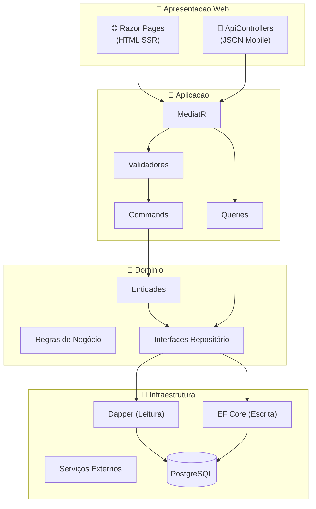

# Manifesto Monolítico — Sistema Modulo_Monolitico (.NET / SSR "API-Ready")

> ⚡ **ESTE É O MANIFESTO ATIVO** para o projeto `c:\Projeto\Sistema\Modulo_Monolitico`. Toda regra arquitetural, de logging, banco, segurança e UI deste projeto está aqui. Não consulte outros manifestos de back-end, front-end ou mobile para este projeto.

> **Premissa de Ouro**: O framework web (Razor Pages) é apenas um "detalhe de apresentação". A regra de negócio **não pode saber** que existe um HTML ou uma requisição HTTP.

Este documento dita as normas arquiteturais, estruturais e operacionais para o desenvolvimento do ERP Web usando a estratégia de **Monolito SSR com preparação nativa para API Mobile**. Ele substitui e unifica os antigos Manifestos de Back-End e Front-End separados.


---

## 🎯 As 3 Premissas Fundamentais

### 1. A Camada de Aplicação Devolve DTOs, Nunca ViewModels

O serviço (ou caso de uso) processa a lógica e retorna um **objeto puro (DTO)**. Quem transforma esse DTO em uma página bonita com botões é a camada de **Apresentação (Web)**. Se amanhã um App Mobile consumir, o `ApiController` pega esse **exato mesmo DTO** e serializa em JSON. O serviço central **não muda uma linha**.

```
[Razor Page] ──► DTO ──► Renderiza HTML
[ApiController] ──► DTO ──► Serializa JSON
                    ▲
            Mesmo objeto puro
```

### 2. Abstinência de HttpContext nas Regras de Negócio

**Nunca** passe `HttpContext`, `Request`, `Session`, `ClaimsPrincipal` ou qualquer objeto do pipeline HTTP para dentro dos serviços ou casos de uso. Se o serviço precisar do ID do usuário logado, receba apenas um `Guid userId` como parâmetro. O mobile não tem "Sessão" tradicional — ele usa Token. Isolando isso, o backend atende ambos.

```csharp
// ❌ PROIBIDO
public ResultadoDto Processar(HttpContext contexto) { ... }

// ✅ CORRETO
public ResultadoDto Processar(Guid usuarioId, Guid empresaId) { ... }
```

### 3. CQRS com MediatR (O Grande Facilitador)

O padrão de mensageria interna faz com que a página web (SSR) apenas envie um comando:

```csharp
// Na Razor Page
var resultado = await _mediator.Send(new CriarRegistroCommand { ... });

// No ApiController (futuro mobile)
var resultado = await _mediator.Send(new CriarRegistroCommand { ... });
```

A mesma chamada de comando, a mesma pipeline de validação, o mesmo resultado.

---

## 🏰 Estrutura da Arquitetura

```
📁 Solucao/
├── 📁 src/
│   ├── 📁 Apresentacao.Web/          ← Camada Externa (Front + Back juntos)
│   │   ├── Program.cs
│   │   ├── 📁 Pages/                 ← Razor Pages (.cshtml) — o "front-end"
│   │   ├── 📁 ApiControllers/        ← Semente do Mobile (JSON puro)
│   │   ├── 📁 Middlewares/           ← Tratamento global de erros (HTML vs JSON)
│   │   ├── 📁 ViewModels/            ← Transformação DTO → tela (só aqui)
│   │   └── 📁 wwwroot/               ← CSS, JS, Imagens (estáticos)
│   │
│   ├── 📁 Aplicacao/                  ← O verdadeiro "Backend"
│   │   ├── 📁 CasosDeUso/            ← Commands (Escrita) e Queries (Leitura)
│   │   ├── 📁 DTOs/                  ← Estruturas de dados de trânsito
│   │   ├── 📁 Interfaces/            ← Contratos de serviços
│   │   └── 📁 Validadores/           ← FluentValidation
│   │
│   ├── 📁 Dominio/                    ← O Coração (não sabe que HTTP existe)
│   │   ├── 📁 Entidades/             ← Classes principais (Veiculo, Motorista)
│   │   ├── 📁 RegrasDeNegocio/       ← Lógica pura
│   │   └── 📁 InterfacesDeRepositorio/ ← Contratos de persistência
│   │
│   └── 📁 Infraestrutura/            ← O Motor Técnico
│       ├── 📁 AcessoADados/           ← DbContext, Dapper, Connection Pooling
│       └── 📁 Servicos/              ← E-mail, integrações HTTP externas
│
└── 📁 tests/                         ← Garantia de Evolução (Obrigatório)
    ├── 📁 Dominio.Testes/             ← Testes de regras puras
    ├── 📁 Aplicacao.Testes/           ← Testes de Handlers (Caminho Feliz e Negócio)
    └── 📁 Infraestrutura.Testes/      ← Testes de integração/infra
```

---

## 🧩 Módulos do Sistema

O sistema é organizado em módulos de negócio. Cada feature nova deve se encaixar em um módulo — se não se encaixar em nenhum, provavelmente é candidata ao módulo **Base** (compartilhado) ou é um novo módulo.

### Módulo Base (sem dono, serve a todos)
Cadastros e infraestrutura compartilhada. Nenhum módulo de negócio específico.

| Contexto | Conteúdo |
|---|---|
| **Auth** | Login, token, refresh, validação de código |
| **Contatos** | Pessoa Física e Jurídica — base de qualquer relacionamento |
| **Empresas** | Contas, Empresas (filiais), Multi-Tenancy |
| **Usuários / RBAC** | Usuários, Grupos, Permissões, Vínculos |
| **Configurações** | Parâmetros globais do sistema |
| **Vendedores** | Cadastro de vendedores e tipos de vendedor |

> **Regra**: se a entidade é referenciada por mais de um módulo de negócio, ela pertence ao Base.

---

### Módulos de Negócio

| Módulo | Rota Raiz | Conteúdo |
|---|---|---|
| **Área do Cliente** | `/Cliente` | Cashback (consultar), Fidelidade (consultar), Histórico, Vagas (cadastrar currículo), Agendamento (marcar) |
| **Serviços** | `/Servicos` | Cashback (oferecer), Fidelidade (emitir QR), OS, Nota de Serviço, Vagas (publicar), Agendamento (gerenciar agenda) |
| **Varejo** | `/Varejo` | PDV, Caixa |
| **ERP** | `/ERP` | Pedido, Estoque |
| **Financeiro** | `/Financeiro` | Contas a Pagar, Contas a Receber, Bancos |
| **Logística** | `/Logistica` | Expedição, Rotas de Entrega |
| **Cidade** | `/Cidade` | Achados e Perdidos, Vagas (portal de busca) |
| **CRM** | `/CRM` | Ligações, Contatos/Prospects, Marketing, Campanhas |
| **Help Desk** | `/HelpDesk` | Chamados, Incidentes |
| **Fiscal** | `/Fiscal` | Impostos, Mensageria NFe |
| **Admin** | `/Administracao` | Dashboard, Logs, Gestão de Usuários/Acessos, Motor de Notificações |

### Vagas de Emprego — Módulo Distribuído
Vagas é uma feature com partes em três módulos distintos:
- **Serviços**: empresa publica e gerencia vagas → `Pages/Servicos/Vagas/`
- **Cliente**: candidato cadastra currículo e se candidata → `Pages/Cliente/Vagas/`
- **Cidade**: portal público de busca de vagas → `Pages/Cidade/Vagas/`

### Regra de Organização de Pastas

```
Pages/
├── Base/               ← Contatos, Empresas, Vendedores, TiposVendedor, Configuracoes
├── Shared/             ← Layouts, Base PageModels, Toolbars, Components
├── Auth/
├── Principal/          ← Hub raiz de navegação
├── Cliente/
│   └── Vagas/
├── Servicos/
│   ├── Cashback/
│   ├── Fidelidade/
│   └── Vagas/
├── Varejo/
├── ERP/
├── Financeiro/
├── Cidade/
│   └── Vagas/
├── CRM/
├── HelpDesk/
├── Fiscal/
└── Administracao/

CasosDeUso/
├── Base/               ← Auth, Usuarios, Grupos, Contatos, Vendedores
├── Servicos/
│   ├── Cashback/
│   └── Fidelidade/
├── Administracao/
└── [demais módulos conforme implementação]
```

---

## 📁 1. Apresentacao.Web (Camada Externa)

É aqui que a mágica do SSR acontece. O .NET processa e entrega o HTML renderizado.

### Program.cs
Configura a Injeção de Dependência, o pipeline web, o MediatR e a conexão com o banco. **Único ponto de bootstrap** do sistema.

### Pages/ (Razor Pages)
Arquivos `.cshtml` — o "front-end" vive aqui. Cada Page:
- Extrai dados do formulário ou da URL
- Monta um `Command` ou `Query` e envia ao `MediatR`
- Recebe o DTO de resposta
- Opcionalmente transforma em ViewModel para renderização
- Renderiza o HTML

```csharp
/// <summary>
/// Page responsável pela criação de um novo registro.
/// Monta o comando e delega ao MediatR.
/// </summary>
public class CriarRegistroModel : PageModel
{
    private readonly IMediator _mediator;

    public CriarRegistroModel(IMediator mediator)
    {
        _mediator = mediator;
    }

    [BindProperty]
    public CriarRegistroFormulario Formulario { get; set; } = new();

    public async Task<IActionResult> OnPostAsync()
    {
        var comando = new CriarRegistroCommand
        {
            Nome = Formulario.Nome,
            UsuarioId = User.ObterUsuarioId() // Extension method limpo
        };

        var resultado = await _mediator.Send(comando);

        if (!resultado.Sucesso)
        {
            ModelState.AddModelError("", resultado.Mensagem);
            return Page();
        }

        TempData["Mensagem"] = "Registro criado com sucesso!";
        return RedirectToPage("/Registros/Index");
    }
}
```

> **Dica HTMX**: Use HTMX no HTML para dar fluidez de SPA sem projeto front-end separado. Atributos como `hx-post`, `hx-swap`, `hx-target` permitem atualizações parciais da página sem JavaScript pesado.

### ApiControllers/ (A Semente do Mobile)
Pasta que **hoje pode estar vazia**, mas que amanhã abrigará os Controllers retornando JSON puro para o App. Ficam no **mesmo projeto web**, reaproveitando a mesma infraestrutura.

```csharp
/// <summary>
/// Controller API para consumo do App Mobile.
/// Reaproveita os mesmos Commands/Queries do MediatR.
/// </summary>
[ApiController]
[Route("api/v1/[controller]")]
[Authorize]
public class RegistrosApiController : ControllerBase
{
    private readonly IMediator _mediator;

    public RegistrosApiController(IMediator mediator)
    {
        _mediator = mediator;
    }

    [HttpPost]
    public async Task<IActionResult> Criar([FromBody] CriarRegistroRequest request)
    {
        var comando = new CriarRegistroCommand
        {
            Nome = request.Nome,
            UsuarioId = User.ObterUsuarioId()
        };

        var resultado = await _mediator.Send(comando);

        if (!resultado.Sucesso)
            return BadRequest(resultado);

        return Ok(resultado);
    }
}
```

### Middlewares/
Tratamento global de erros com **detecção inteligente**:
- Se a chamada vier do navegador → renderiza página de erro 500 em HTML
- Se a chamada vier da API (`Accept: application/json`) → devolve JSON de erro amigável

```csharp
/// <summary>
/// Middleware que diferencia erros para SSR (HTML) e API (JSON).
/// </summary>
public class TratamentoGlobalErrosMiddleware
{
    public async Task InvokeAsync(HttpContext contexto, RequestDelegate proximo)
    {
        try
        {
            await proximo(contexto);
        }
        catch (Exception ex)
        {
            if (contexto.Request.Path.StartsWithSegments("/api"))
            {
                contexto.Response.StatusCode = 500;
                contexto.Response.ContentType = "application/json";
                await contexto.Response.WriteAsJsonAsync(new { erro = "Erro interno." });
            }
            else
            {
                contexto.Response.Redirect("/Erro");
            }
        }
    }
}
```

### wwwroot/
Arquivos estáticos servidos pelo pipeline ASP.NET (e, em produção, podem ser cacheados pelo Nginx).

```
wwwroot/
├── css/                    ← Design System global (design-system.css, site.css)
├── js/                     ← Utilitários globais (app.js, form-snapshot.js)
├── img/
├── lib/
└── Contextos/              ← CSS/JS por bounded context (ver seção Front-End)
    ├── Autenticacao/
    │   ├── css/   (comum.css + um .css por tela)
    │   └── js/    (comum.js + um .js por tela)
    ├── ERP/
    │   ├── css/
    │   └── js/
    ├── CRM/
    └── [Modulo]/
```

**Regra**: o `.cshtml` contém **markup e referências** — não blocos `<style>` nem `<script>` de negócio. Compartilhado do contexto: `comum.css` / `comum.js` (a pasta já identifica o módulo).

---

## 📁 2. Aplicacao (O Verdadeiro "Backend")

Camada que o site SSR e o futuro App Mobile **compartilham 100%**. Sem referência a HTML, HTTP ou qualquer framework web.

### CasosDeUso/
Contém os **Commands** (Escrita) e **Queries** (Leitura) organizados pelo padrão CQRS via MediatR.

```
📁 CasosDeUso/
├── 📁 Registros/
│   ├── 📁 Comandos/
│   │   ├── CriarRegistroCommand.cs
│   │   └── CriarRegistroCommandHandler.cs
│   └── 📁 Consultas/
│       ├── ListarRegistrosQuery.cs
│       └── ListarRegistrosQueryHandler.cs
```

```csharp
/// <summary>
/// Comando para criação de um novo registro no sistema.
/// Transporta apenas dados primitivos — sem dependência de HTTP.
/// </summary>
public class CriarRegistroCommand : IRequest<ResultadoDto>
{
    public string Nome { get; set; } = string.Empty;
    public Guid UsuarioId { get; set; }
}

/// <summary>
/// Handler que orquestra a criação do registro.
/// Valida, persiste e retorna DTO puro.
/// </summary>
public class CriarRegistroCommandHandler : IRequestHandler<CriarRegistroCommand, ResultadoDto>
{
    private readonly IRegistroRepositorio _repositorio;

    public CriarRegistroCommandHandler(IRegistroRepositorio repositorio)
    {
        _repositorio = repositorio;
    }

    public async Task<ResultadoDto> Handle(CriarRegistroCommand request, CancellationToken cancellationToken)
    {
        // Regra de negócio pura — zero HTTP aqui
        var entidade = new Registro(request.Nome, request.UsuarioId);
        await _repositorio.CriarAsync(entidade);

        return new ResultadoDto { Sucesso = true, Mensagem = "Registro criado." };
    }
}
```

### DTOs/
Estruturas de dados de trânsito. **Nunca** contêm lógica de negócio. São classes/records simples com propriedades.

### Interfaces/
Contratos de serviços e repositórios que a camada web chama. A implementação concreta vive na Infraestrutura.

### Validadores/
Regras usando **FluentValidation** garantindo que os dados de entrada (seja do formulário web ou do JSON do mobile) estejam corretos. Executados automaticamente na pipeline do MediatR.

```csharp
/// <summary>
/// Validador do comando CriarRegistro.
/// Atende tanto formulário HTML quanto payload JSON.
/// </summary>
public class CriarRegistroCommandValidador : AbstractValidator<CriarRegistroCommand>
{
    public CriarRegistroCommandValidador()
    {
        RuleFor(x => x.Nome)
            .NotEmpty().WithMessage("Nome é obrigatório.")
            .MaximumLength(200).WithMessage("Nome excede 200 caracteres.");

        RuleFor(x => x.UsuarioId)
            .NotEmpty().WithMessage("Usuário é obrigatório.");
    }
}
```

---

## 📁 3. Dominio (O Coração)

A regra imutável. **Não sabe** se está rodando na nuvem, em um servidor local, para web ou para mobile.

### Entidades/
Classes principais do negócio com regras de integridade embutidas.

### RegrasDeNegocio/
Lógica pura. Cálculos, validações de domínio, invariantes.

### InterfacesDeRepositorio/
Contratos dizendo "Eu preciso salvar/ler isso", sem saber **como** será feito.

```csharp
/// <summary>
/// Contrato de persistência de Registros.
/// A implementação concreta (Dapper, EF, etc.) vive na Infraestrutura.
/// </summary>
public interface IRegistroRepositorio
{
    Task CriarAsync(Registro entidade);
    Task<Registro?> ObterPorIdAsync(Guid id);
    Task<IEnumerable<Registro>> ListarPorEmpresaAsync(Guid empresaId);
    Task AtualizarAsync(Registro entidade);
    Task DeletarAsync(Guid id); // Soft delete
}
```

---

## 📁 4. Infraestrutura (O Motor Técnico)

Onde a implementação concreta acontece. Fundamental para aguentar alta concorrência.

### AcessoADados/
- **Dapper** para leituras pesadas (Queries) — performance crua, SQL puro
- **EF Core** para persistência (Commands) — conveniência de tracking
- **Connection Pooling** agressivo via Npgsql nativo
- **PostgreSQL** como SGBD (espelhando o Manifesto de Banco de Dados existente)

### Servicos/
Implementação de integrações externas: envio de e-mails, comunicação com APIs terceiras, storage de arquivos.

---

## 🚀 O Fluxo Prático

### HOJE — SSR pelo Navegador

```
1. Usuário clica "Salvar" no HTML
2. Requisição bate na Razor Page (Apresentacao.Web)
3. Page monta CriarRegistroCommand → envia ao MediatR (Aplicacao)
4. Handler processa regra, salva no banco → devolve ResultadoDto
5. Razor Page pega o DTO → renderiza nova tela HTML "Salvo com sucesso!"
```

### AMANHÃ — Via App Mobile

```
1. App envia JSON para /api/registros
2. Requisição bate no ApiController (Apresentacao.Web)
3. Controller monta o MESMO CriarRegistroCommand → envia ao MediatR
4. Handler processa regra, salva no banco → devolve o MESMO ResultadoDto
5. ApiController pega o DTO → devolve JSON HTTP 200 pro App
```



---

## 📐 Diretrizes Operacionais (Herdadas dos Manifestos Vigentes)

### Gerenciamento de Segredos e Versionamento (Git)
Fica estabelecida a política de **Zero Trust** para o repositório de código fonte (GitHub/GitLab):
1. **O Cofre (`Cofre_Privado`):** Nenhum arquivo de documentação contendo IPs de servidores, chaves de API, tokens de acesso ou senhas (ex: `KingHost`, `Cloudflare`) poderá ser rastreado pelo Git. Estes arquivos devem residir estritamente no diretório local protegido `.gitignore` chamado `Documentação/Cofre_Privado/`.
2. **Appsettings Template:** O arquivo principal `appsettings.json` servirá exclusivamente como um "template" estrutural e só poderá ser versionado contendo strings vazias ou *dummy passwords* (`SUA_SENHA_AQUI`).
3. **Appsettings Locais:** Os arquivos contendo segredos reais (`appsettings.Development.json` e `appsettings.Production.json`) são permanentemente bloqueados via `.gitignore`. Cada novo ambiente ou desenvolvedor deverá solicitá-los manualmente ao titular do projeto.

### A. Mindset de Desenvolvimento (Thread Safety & Processo)

* **Thread Safety**: Sempre questione ou assegure-se de que a implementação possui suporte _Thread-Safe_, garantindo estabilidade para contexto de Web (concorrência com 2.000-4.000 usuários simultâneos).
* **Fluxo de Trabalho de Criação**: Ao trabalhar com tabelas, obedeça a ordem: 1) **DTOs** → 2) **Repositórios/DAOs** → 3) **Handlers (MediatR)** → 4) **Testes de Unidade** → 5) **Pages/Controllers**.
* **Definition of Done (DoD)**: Uma funcionalidade só é considerada "concluída" se o seu respectivo CommandHandler ou QueryHandler possuir, no mínimo, um teste unitário cobrindo o "Caminho Feliz" e um teste cobrindo a principal validação de negócio.
* **Limpeza de "Sujeira" (Housekeeping)**: Após a conclusão de qualquer tarefa, scripts de migração temporários, pastas de scratch ou arquivos de log de build intermediários criados durante o desenvolvimento DEVEM ser removidos para manter a integridade do ambiente.
* **Especialização de Telas Genéricas**: Evite o uso de múltiplos `if/else` em telas com comportamentos distintos (ex: Leitor de QR Code para Cashback vs Fidelidade). O padrão correto é criar uma base genérica (Base Page ou Componente) e especializar o comportamento em telas/handlers específicos para cada necessidade de negócio.
* **Modularidade de Implementações Externas**: Toda integração externa relevante (gateway de pagamento, serviço de e-mail, armazenamento de arquivos, geolocalização, etc.) deve ser encapsulada atrás de uma **interface de contrato** e um **adaptador isolado**. A troca de fornecedor deve exigir apenas a substituição do adaptador — nunca alterações espalhadas nos Handlers ou Pages.
* **Restrição de IA - Proximos_Passos.md**: A IA assistente (Antigravity) está expressamente **proibida** de editar, sugerir alterações ou manipular o conteúdo do arquivo `Proximos_Passos.md`. Este arquivo é de controle manual exclusivo do usuário para gestão de roadmap e prioridades. A IA deve apenas lê-lo para contexto, se necessário, mas nunca propor modificações nele.

### B. Injeção de Dependência & Ciclo de Vida

| Tipo | Ciclo de Vida | Justificativa |
|---|---|---|
| Repositórios / DAOs | `Scoped` | Nascem e morrem com a requisição, liberação segura de conexões |
| Handlers (MediatR) | `Transient` | Sem estado, instanciados por chamada |
| Serviços de Negócio | `Scoped` | Dependem dos repositórios para intermediar validações |
| Configurações / Cache | `Singleton` | Stateless e globais (Ex: provedor de IDs, interfaces de Cache) |
| Jobs Background (Hangfire) | `Transient` / `Scoped` | Instâncias cegas da requisição inicial |

### C. Banco de Dados & Persistência

- **SGBD**: PostgreSQL
- **Conexão Direta da IA**: A IA assistente (Antigravity) possui a capacidade de se conectar diretamente ao PostgreSQL local da máquina via `psql` pelo terminal (Powershell). A IA é responsável por aplicar o DBML, criar bancos, e rodar scripts de migração/verificação. O usuário só precisa fornecer a senha do usuário `postgres` quando necessário.
- **Leitura**: Dapper (SQL puro, performance crua) para Queries pesadas
- **Escrita**: EF Core para persistência (Commands), conveniência de tracking
- **FKs físicas utilizadas** em tabelas estruturais — o schema usa `FOREIGN KEY ... REFERENCES` via `ALTER TABLE` para garantir integridade das relações nucleares (ex: `usuarios_empresas`, `contatos`, `empresas`). Ao criar novas tabelas, avaliar a necessidade de FK nas colunas relacionais
- **Soft Delete**: Os campos `deleted_at` ou `data_exclusao` (TIMESTAMPTZ) sinalizam inatividade operacional e deleção lógica.
- **UUID gerado no banco**: Operações `INSERT` retornam o novo identificador via `RETURNING id`
- **Connection Pooling**: Npgsql nativo, configuração agressiva
- **Extensões PostgreSQL**: Toda nova `EXTENSION` adicionada deve ser incluída na rotina de backup

**Colunas Padrão Obrigatórias** — Toda tabela no sistema herda:

```sql
url_imagem TEXT,
status TEXT NOT NULL DEFAULT 'ativo',
ordem INT NOT NULL DEFAULT 0,
data_inclusao TIMESTAMPTZ NOT NULL DEFAULT now(),
data_ultima_atualizacao TIMESTAMPTZ,
data_exclusao TIMESTAMPTZ -- ou deleted_at TIMESTAMPTZ
```

**Opção "SEM INFORMAÇÃO" Obrigatória**: Toda tabela que possua campos de seleção categórica (tipo, modalidade, status, segmento, etc.) deve garantir que o valor `NULL` ou um literal `'sem_informacao'` seja uma opção válida e tratada. A ausência de informação é um estado legítimo de negócio — nunca deve resultar em erro de validação ou exclusão silenciosa de registros em relatórios e listagens. Em campos de enum no C#, sempre inclua o membro `NaoInformado` (ou equivalente) como primeiro valor do enum, com valor numérico `0`.

- `data_inclusao`: Nunca nula. Timestamp exato de inserção.
- `data_ultima_atualizacao`: Iniciada nula, automatizada por TRIGGER a cada `UPDATE`.
- `data_exclusao` / `deleted_at`: Exclusiva para Soft Delete. Usar sempre `TIMESTAMPTZ` (UTC).

**Chave Primária**: A coluna primária UUID chama-se estritamente **`id`**. Nunca `id_produto` ou `produto_id` no campo primário da própria tabela. Nomes estendidos são restritos apenas para relacionamentos.

**Gatilhos de Auditoria**: Criou ou alterou uma tabela? Confira a necessidade de vincular o trigger de captura em `auditoria_registros`.

**Índice de Performance**: Toda tabela grande ou com soft delete deve criar um índice parcial de deleção lógica:
```sql
CREATE INDEX IF NOT EXISTS idx_nome_tabela_not_deleted ON public.nome_tabela(deleted_at) WHERE deleted_at IS NULL;
-- ou usando data_exclusao:
CREATE INDEX IF NOT EXISTS idx_nome_tabela_not_deleted ON public.nome_tabela(data_exclusao) WHERE data_exclusao IS NULL;
```

### D. Segurança & Identidade (Blindagem)

- **Autenticação Extrema**: Validação estrita de _Issuer_ e _Audience_ dentro do JWT. Assinatura quebra a requisição se algo der errado.
- **Centralização (SecurityService)**: Tokens, Hashes de Senha são gerados e validados apenas pela camada central de Segurança. Lógicas em Pages/Controllers manipulando texto (ex: _Replace_ do "Bearer ") estão **erradas**.
- **Proteção Horizontal**: Não basta o token — controle obrigatório validando `dono_id == userIdLogado` em toda escrita.
- **Autenticação Dupla**: Cookie para SSR (navegador), Bearer Token para API Mobile.
- **Cookies HTTPOnly**: Tokens de refresh vivem com propriedade HTTPOnly contra XSS.

#### D.1 — Schema e serviço único de cookies (`AuthCookieSchema` + `IAuthCookieService`)

**Proibido** duplicar nomes de cookie, paths ou durações nas Pages. Toda emissão, renovação e limpeza passa pelo serviço central.

| Artefato | Caminho | Papel |
|---|---|---|
| `AuthCookieSchema` | `Web/Configuracoes/AuthCookieSchema.cs` | Nomes, paths, durações — **única fonte de verdade** |
| `IAuthCookieService` | `Web/Servicos/IAuthCookieService.cs` | Contrato de emissão/limpeza |
| `AuthCookieService` | `Web/Servicos/AuthCookieService.cs` | Implementação (`HttpOnly`, `Secure`, `SameSite`, paths) |

Cookies padronizados:

| Constante | Uso |
|---|---|
| `AccessToken` | JWT curto (15 min), path `/` |
| `RefreshToken` | Renovação (7 dias), path `/Auth/RenovarToken`, HTTPOnly |
| `EmpresaAtivaId` / `EmpresaAtivaNome` | Contexto de empresa selecionada |
| `EmailCodigoEnviado` | Throttle de reenvio de código de e-mail |

Leituras nas Pages usam `AuthCookieSchema.*` ou delegam ao serviço — nunca string literal `"auth_token_v2"`.

#### D.2 — Rate limiting reutilizável (`IRateLimitService`)

**Proibido** helpers ad hoc por fluxo (`LoginProtecaoHelper`, etc.). Toda proteção por tentativas usa políticas declarativas:

| Artefato | Caminho |
|---|---|
| `RateLimitPolitica` | `Aplicacao/Servicos/RateLimitPolitica.cs` |
| `RateLimitPoliticas` | `Aplicacao/Servicos/RateLimitPoliticas.cs` — catálogo de limites |
| `IRateLimitService` | `Aplicacao/Interfaces/IRateLimitService.cs` |
| `RateLimitService` | `Aplicacao/Servicos/RateLimitService.cs` |

Modos: `Falhas` (login, código inválido) e `Solicitacoes` (esqueci senha, reenvio de e-mail).

Políticas atuais (janela 15 min):

| Política | E-mail+IP | IP |
|---|---|---|
| `Login` | 5 falhas | 20 falhas |
| `RecuperacaoSolicitacao` | 3 | 10 |
| `RecuperacaoValidacao` | 5 falhas | 15 falhas |

Uso nos Handlers:

```csharp
if (await _rateLimit.EstaBloqueadoAsync(
        RateLimitPoliticas.Login, request.Email, request.IpAddress, cancellationToken))
{
    await _rateLimit.AplicarAtrasoRespostaAsync(cancellationToken);
    return AuthResultadoDto.Falha("Credenciais inválidas.");
}
```

IP do cliente: `HttpRequestExtensions.ObterIpCliente()` na camada Web — repassar como string ao Command, **nunca** `HttpContext` no Handler.

#### D.3 — Headers de segurança e CSP

Middleware `UseSecurityHeaders` (`SecurityHeadersExtensions.cs`): `X-Frame-Options`, `nosniff`, `Referrer-Policy`, `Permissions-Policy` (`camera=(self)` para QR), HSTS em HTTPS, **Content-Security-Policy** alinhada aos recursos reais (Google OAuth, Fonts, html5-qrcode via `unpkg` fixado).

#### D.4 — OWASP / hardening aplicado (Auth e UI)

- **Mensagens genéricas** em login e recuperação de senha — não revelar se e-mail existe.
- **Revogação de sessões** anteriores no login (local + Google) e na redefinição de senha.
- **Login Google**: validação de `Origin` + header `X-Requested-With`.
- **XSS**: `innerHTML` proibido com dados dinâmicos — usar `escHtml()` / DOM seguro em `app.js`; modais e toasts escapam conteúdo.
- **Validação dupla** mantida: UX no front + FluentValidation no Handler.
- **LGPD — Consentimento Explícito**: Dados pessoais de um usuário **jamais** são expostos a outro (pessoa ou empresa) sem consentimento explícito e registrado. Exemplos práticos:
  - Ao se candidatar a uma vaga, o candidato autoriza ou não o envio de seus dados de contato ao recrutador — essa escolha deve ser capturada no ato e armazenada junto à candidatura.
  - Currículos, histórico médico, localização precisa e dados financeiros só trafegam mediante autorização ativa.
  - Logs de auditoria que contenham dados pessoais devem ser acessíveis apenas a quem tem perfil de Administrador de Conta.
  - A regra vale para qualquer módulo: Achados & Perdidos, Vagas, Cashback, Fidelidade e similares.

#### D.5 — Rotas centralizadas (`ModuloRotas`) e telas standalone por contexto

**Padrão canônico de URL:** `/Contextos/{Contexto}/{Pagina}` — ex.: `/Contextos/Autenticacao/Login`, `/Contextos/Principal/Hub`.

| Recurso | Onde fica |
|---|---|
| Constantes de **todas** as telas | `Web/Core/ModuloRotas.Telas.cs` (ex.: `ModuloRotas.Erp.Produtos_Novo`) |
| Mapa página → rota canônica | `Web/Core/ModuloRotas.Paginas.cs` (`ModuloRotas.Paginas`) |
| Redirects legados (bookmarks) | `Web/Core/ModuloRotas.Legado.cs` + `UsarRedirecionamentosLegados()` |
| Aplicar rotas no pipeline | `ConfigurarRotasCanonicas()` em `AddRazorPages` |
| Redirect / JSON sucesso | `ModuloRotas.Redirecionar(...)`, `ModuloRotas.JsonSucesso(...)` |
| Base standalone (Layout = null) | `AutenticacaoStandalonePageModel` + `PaginaSlug` |
| Head/Foot genéricos | `_ContextoStandaloneHead`, `_ContextoStandaloneFoot`, `_ContextoStandaloneThemeToggle` |

Regras:

- **`.cshtml` usa só `@page`** — sem path na diretiva. A rota canônica vem de `ModuloRotas.Paginas` + convenção `AddPageRoute` no `Program.cs`.
- **Links, redirects e JSON** usam constantes de `ModuloRotas` — proibido string literal de URL nova no código.
- **Copiar tela nova:** herdar base do contexto, `@page` sem path, registrar rota em `ModuloRotas` (regenerar via `scripts/gerar_rotas.py` quando mover/criar Pages).
- URLs antigas (`/Auth/*`, `/Contatos`, `/ERP/Index`, etc.) redirecionam via `RedirecionamentosLegados`.

### E. Observabilidade Híbrida Inteligente (Smart Logging — Serilog)

- **Paradoxo Flight Recorder (Caixa Preta)**: Logger via Buffer Scoped na Memória. Requisição OK → RAM descarta (Zero I/O). Requisição falhou → flush completo ao disco com informações que antecederam a exceção.
- **Instrumentação**: A primeiríssima linha de métodos habilitados deve ser um Logger expondo o método e as variáveis recebidas.
- **Structured Logging**: Propriedades tipadas, não strings concatenadas.
- **Log Tag Padronizado**: Toda classe de infraestrutura ou handler encapsula a etiqueta padronizada: `private const string LogTag = "LOG :: [NomeDaClasse]";`
- **Rastreabilidade de Rede**: Logs de integrações HTTP externas expõem Endpoint acionado e Payload do corpo.
- **Rastreabilidade de Banco**: Logs de operações de banco expõem `record_id` afetado e `affectedRows`.
- **Erros**: StackTrace completo sem truncamento.

### F. Responsabilidade Única (SRP) — Proibição de God Classes

- **[x] Regra Absoluta**: Código limpo e objetivo. Uma classe ou função resolve **um único** problema.
- **Proibição de Duplicação (DRY)**: Não repita código em classes/telas ("units") diferentes. Se uma rotina salva algo, processa uma regra ou tem um comportamento específico, decida onde ela deve morar definitivamente. Ou a regra pertence unicamente a um Serviço/Handler específico, ou deve ser extraída para um recurso/ferramenta/serviço global. Múltiplas telas devem usar o mesmo recurso centralizado, nunca reimplementar a lógica isoladamente.
- _God Classes_ — classes que validam, salvam, disparam e-mails, emitem notas, gerenciam estado de UI e fazem log ao mesmo tempo — são **PROIBIDAS** sem exceção. Funções com mais de ~40 linhas devem ser questionadas.
- **Separação Obrigatória de Formulários (Novo vs Editar)**: É expressamente proibido utilizar uma única Razor Page (ex: `Editar.cshtml`) para gerenciar as rotinas de Criação e Edição simultaneamente. Toda entidade deve possuir rotas estritas e separadas: `/Novo` para novos cadastros (iniciando formulários limpos) e `/Editar` para atualizações (exigindo ID via URL). Essa regra previne a criação de "God Pages" que acumulam `if/else` para comportamentos visuais conflitantes e mantém o Princípio de Responsabilidade Única (SRP) na camada de Apresentação.
- Se o fluxo for naturalmente complexo, a função principal deve atuar como **"Orquestradora"**, delegando etapas menores para serviços isolados.
- Handlers do MediatR que crescem demais devem ser decompostos em _sub-handlers_ ou serviços de domínio.
- **Rotinas Grandes Fora das Telas**: Nenhuma Page, Controller ou View deve conter lógica de negócio de mais de uma etapa. Se um botão dispara uma sequência de ações (validar → processar → notificar → registrar), cada etapa pertence a um Handler ou Serviço isolado — a tela chama apenas o ponto de entrada. Em processos com múltiplas etapas visíveis ao usuário, questione sempre se deveria ser uma nova tela ou sub-tela.
- **Nomenclatura Orientada à Metodologia**: Nenhuma tela, classe, relatório ou caso de uso deve ser nomeado apenas pelo contexto do cliente ou pela empresa (ex.: `TelaAndreense`, `RelatorioClienteXYZ`). O nome deve refletir a **metodologia de uso**: `ListagemCandidaturasPorVaga`, `RelatorioFaturamentoPorPeriodo`, `ProcessarCarimboFidelidadeCommand`. Isso garante reaproveitamento, compreensão imediata e portabilidade entre clientes.

### G. Processamento Background (Hangfire)

- **Engine**: Hangfire hospedado junto na persistência PostgreSQL.
- **Painel**: Autenticação obrigatória restrita no Endpoint (`/hangfire`) com Roles específicas.
- **Jobs**: Utilizar sintaxe limpa de chamada genérica do Hangfire para evitar serializações quebradas de classes robustas.

### H. Tratamento de Erros & Exceções (Para o Usuário)

- **Erros Semânticos**: Respostas negativas convertem falhas obscuras para textos lúdicos ao usuário e expõem códigos para o time técnico mapear o rastreio.
- **Nunca expor detalhes de TryCatch** de volta para a vista do usuário.
- O Middleware global diferencia: SSR → página de erro bonita; API → JSON de erro com código e mensagem amigável.
- **Páginas de Erro Customizadas**: `/Erro/404`, `/Erro/500` com design coerente ao sistema.

### I. Auditoria & Histórico de Negócio

- **Auditoria de Tela**: Toda movimentação importante (acessos, criações, aprovações, exclusões, modificações em permissões) emite traços de gravação passivos ao backend sem que o comportamento da UI dependa disso.
- **Tabela `auditoria_registros`**: Imutável (`bigserial`, sem soft delete), populada por trigger. Grava `conta_id`, `table_name`, `action`, `record_id`, `old_values`, `new_values`, `user_id`.
- **Tela de Auditoria Unificada**: Deve responder em dois modos:
  1. **Modo Específico**: Par `tableName` + `recordId` — ciclo de vida do registro na linha do tempo.
  2. **Modo Geral**: Esteira global de logs do usuário (`userId`) — permite rastrear "onde apaguei?".

### J. Organização Vertical por Contexto

```
📁 Aplicacao/
├── 📁 CasosDeUso/
│   ├── 📁 Registros/
│   │   ├── 📁 Comandos/
│   │   └── 📁 Consultas/
│   ├── 📁 Usuarios/
│   ├── 📁 Agendamentos/
│   └── 📁 Financeiro/
```

Cada Contexto (Bounded Context) contém seus próprios Commands, Queries, DTOs e Validadores.

### K. Estratégia de Testes (Garantia de Evolução)

A arquitetura desacoplada do framework web é o ambiente perfeito para testes rápidos e eficazes. O projeto de testes é `ModuloMonolitico.TestesIntegracao` e contém **dois tipos** de testes com regras distintas.

#### K.1 — Dois Tipos de Teste, Uma Convenção Clara

| Tipo | Sufixo da Classe | Dependência | Quando roda |
|---|---|---|---|
| **Unitário** | `...Tests` / `...CommandTests` / `...QueryTests` | Moq — sem banco, sem HTTP | Sempre (CI/CD incluso) |
| **Integração** | `...RepositorioTests` | Banco local `localhost:5432` | Apenas com banco local disponível |

> **Regra Absoluta**: Testes de integração **nunca** rodam contra o Supabase (produção). Somente banco local.

#### K.2 — Estrutura de Pastas (espelha os módulos do sistema)

```
ModuloMonolitico.TestesIntegracao/
├── Base/          ← EmpresaRepositorioTests, ContatoRepositorioTests (integração)
├── SaaS/          ← IsolamentoTenantTests, AssinaturaTests (unitários)
├── Auth/          ← LoginCommandTests, RenovarTokenTests (unitários)
├── ERP/           ← (handlers do módulo ERP)
├── Financeiro/    ← (handlers do módulo Financeiro)
└── [Módulo]/      ← Um subdiretório por módulo, espelhando CasosDeUso/
```

> **Regra**: Handler em `CasosDeUso/Auth/` → teste em `Auth/`. O espelhamento é obrigatório.

#### K.3 — Nomenclatura Obrigatória de Testes (Padrão AAA)

```csharp
// Formato: Entidade_Cenario_ResultadoEsperado
[Fact]
public async Task Login_ContaAtiva_DeveEmitirJWTComStatusAtivo() { ... }
```

**Proibido:**
- ❌ `Test1`, `TestLogin`, `TestarAlgo` — nomes sem contexto
- ❌ `Thread.Sleep` — use `async/await` e mocks
- ❌ Dados de teste persistentes no banco após o teste (usar `Dispose()`)

#### K.4 — Cobertura Mínima por Handler

Para cada `CommandHandler` ou `QueryHandler`, são obrigatórios no mínimo:

1. **Caminho Feliz** — fluxo completo OK, retorna DTO esperado
2. **Validação de Negócio** — principal regra impeditiva bloqueando corretamente
3. **Teste do "Não"** — operação recusada não deixa efeito colateral
4. **Idempotência** *(quando aplicável)* — executar 2x não duplica nem lança exceção
5. **Volume em lote** *(operações em lote)* — 1 item, N itens, N-1 itens

#### K.5 — Testabilidade Nativa (por que funciona)

Como a Camada de Aplicação **proíbe** `HttpContext`, `Session` e `ClaimsPrincipal`, instanciar um Handler no teste é simples:

```csharp
// Instancia handler com dependências mockadas — zero setup de servidor web
var handler = new LoginCommandHandler(
    usuarioRepoMock.Object,
    sessaoRepoMock.Object,
    rateLimitMock.Object,
    tokenServiceMock.Object,
    fingerprintMock.Object,
    empresaRepoMock.Object,
    saasRepoMock.Object);

var resultado = await handler.Handle(new LoginCommand { Email = "...", Senha = "..." }, CancellationToken.None);
Assert.True(resultado.Sucesso);
```

#### K.6 — Blindagem Multi-Plataforma

O teste unitário garante que uma alteração feita para a Web não quebrará o contrato do App Mobile amanhã. Como o Handler é agnóstico ao transporte (HTTP, gRPC, console), o teste cobre **ambos os consumidores** de uma vez.

---

## 🗣️ Idioma, Nomenclatura e Simetria Semântica

### Idioma Nativo (PT-BR) e Validações

Todas as regras de negócio, nomes de classes, funções, DTOs e arquivos são escritos em **Português**. Inglês apenas para sintaxe obrigatória de frameworks (ex: `IRequest`, `PageModel`, `async`). Essa regra visa facilitar a interpretação imediata, a auditoria de regras de negócio e a revisão de códigos (mesmo por IA) por parte do proprietário.

**Proibição Absoluta de Mensagens Hardcoded em Inglês e "Tecniquês":**
É terminantemente proibido deixar vazar mensagens padrão de validação do .NET para a interface do usuário (ex: "The Email field is required"). 
Também é proibido utilizar termos técnicos (como "O campo X é obrigatório") nas validações. O sistema deve tratar o usuário de forma clara e amigável.
Toda propriedade de formulário (ViewModel/DTO) deve possuir a anotação explícita de erro em português humanizado:
`[Required(ErrorMessage = "Informe o e-mail.")]`
`[EmailAddress(ErrorMessage = "O e-mail não é válido.")]`

**Política de Senha Forte:**
Qualquer formulário de cadastro ou alteração de senha deve exigir, via `[RegularExpression]`, uma senha forte. O padrão obrigatório é: Mínimo 8 caracteres, contendo pelo menos uma letra maiúscula, uma minúscula, um número e um caractere especial.

### Nomenclatura de Pluralização

- **Pluralização** para gerência de listagem: `RegistrosHandler`, `RegistrosRepositorio`
- **Singularidade** para transferência: `RegistroDto`, `RegistroCommand`

### Conversão de Casing Obrigatória

| Camada | Padrão | Exemplo |
|---|---|---|
| Banco (PostgreSQL) | `snake_case` | `cod_empresa`, `data_inclusao` |
| C# (Propriedades/Classes) | `PascalCase` | `CodEmpresa`, `DataInclusao` |
| C# (variáveis/parâmetros) | `camelCase` | `codEmpresa`, `dataInclusao` |
| JSON da API | `camelCase` | `codEmpresa`, `dataInclusao` |

**Nenhuma variável ou propriedade C#** carrega `snake_case`. Mapeie as colunas do banco convertendo para `PascalCase` nas propriedades e `camelCase` nas variáveis.

### Tolerância Zero para Inglês na Interface (Client-Facing)

É terminantemente **proibido** exibir mensagens de erro, validações ou feedbacks na interface em idioma estrangeiro (inglês). 
- **Validações ASP.NET Core:** Nunca utilize validações automáticas implícitas que gerem mensagens padrão em inglês (ex: `The {0} field is required`). Caso haja necessidade, garanta a tradução no DataAnnotation (ex: `[Required(ErrorMessage="O campo X é obrigatório")]`) ou torne a propriedade Nullable (`string?`) e trate manualmente.
- O sistema é feito para brasileiros. Toda a comunicação com o usuário final deve ser estritamente em **Português do Brasil**, preferencialmente humanizada (sem jargões técnicos brutos).
- **Rótulos de Tela (Labels):** É expressamente proibido exibir nomes literais de variáveis como textos de interface (ex: `ConfirmarNovaSenha`). Todas as propriedades trafegadas em `ViewModels` ou `PageModels` devem obrigatoriamente declarar o atributo `[Display(Name = "Seu Texto Amigável")]` para garantir uma exibição polida.

### A Lei dos Sinônimos (Dicionário de Verbos Único)

Nossa engenharia de termos não tolera poética ou sinônimos aleatórios. Todo novo termo deve ser formalizado no manifesto antes de invadir o código. Ficam **expressamente proibidas** as palavras `Inserir`, `Incluir`, `Salvar`, `Adicionar`, `Novo` para criação de dados.

| Verbo Oficial | Substitui | Uso |
|---|---|---|
| **`Criar...`** | Inserir, Incluir, Salvar, Adicionar, Novo | Criação de recurso |
| **`Atualizar...`** | Modificar, Editar, Salvar alterações | Modificação |
| **`Deletar...`** | Excluir, Remover, Apagar | Remoção lógica |
| **`Obter...`** | Puxar, Pegar, Buscar (1 item) | Resgate unitário |
| **`Listar...`** | Buscar todos, Carregar, getData | Coleções / paginação |
| **`Verificar...`** | Checar, Validar | Retorna true/false |
| **`Vincular... / AdicionarAo...`** | Anexar | Relações entre entidades |
| **`SairDo... / Aceitar...`** | — | Ações relacionais unitárias |
| **`Sincronizar...`** | fetch, handle, requestItem | Reservado para Offline-First Delta |

### Simetria Semântica Inter-Plataforma

A taxonomia de classes, ações e roteamentos obedecem os mesmos fundamentos entre SSR, API e futuro Mobile:

| Ação (Handler/CasoDeUso) | Razor Page | ApiController (futuro) | Mobile (futuro) |
|:---:|:---:|:---:|:---:|
| `CriarRegistroCommand` | `OnPostCriarAsync()` | `POST /api/v1/registros` | `criarRegistro()` |
| `ListarRegistrosQuery` | `OnGetAsync()` | `GET /api/v1/registros` | `listarRegistros()` |
| `ObterRegistroPorIdQuery` | `OnGetAsync(id)` | `GET /api/v1/registros/{id}` | `obterRegistroPorId()` |
| `AtualizarRegistroCommand` | `OnPostAtualizarAsync()` | `PUT /api/v1/registros/{id}` | `atualizarRegistro()` |
| `DeletarRegistroCommand` | `OnPostDeletarAsync()` | `DELETE /api/v1/registros/{id}` | `deletarRegistro()` |

### Documentação Cognitiva (XML Comments)

Fica proibido criar arquivos soltos `.txt` para explicar o que o código faz. Toda Classe Mestra ou Rotina Pública deve ser auto-documentada usando `/// <summary>` (XML Comments) na linha imediatamente superior à sua declaração. O objetivo é ler o propósito ao passar o mouse via IntelliSense.

### Herança Universal de Componentes

Nenhuma Controller Base ou Componente Nativo é invocado de forma livre. Toda classe central **deve possuir uma Herança Customizada Intermediária**:
- Razor Pages herdam de `AppBasePageModel` (não de `PageModel` direto)
- API Controllers herdam de `ApiBaseController` (não de `ControllerBase` direto)
- Componentes Razor reutilizáveis são Wrappers dos nativos — usar `<AppBotao>` em vez de `<button>` direto

> **Proibido Native-Lock**: Extrema cautela ao colar elementos HTML nativos puros em massa. Para mudar o Design System inteiro amanhã, precisamos apenas alterar o componente Wrapper.

#### Hierarquia Obrigatória de Base Classes para Razor Pages

Toda Razor Page deve herdar da classe base adequada ao seu **tipo de operação**. A escolha errada da base implica em perda de funcionalidades de paginação, RBAC, snapshot de formulário e tratamento de mensagens.

| Tipo de Tela | Base Class Obrigatória | Quando Usar |
|---|---|---|
| **Listagem / Consulta / Relatório** | `AppListBasePageModel<TItem, TFiltro>` | Telas com tabelas, filtros e paginação |
| **Formulário de Criação / Edição** | `AppFormBasePageModel<TForm>` | Telas `Novo.cshtml` e `Editar.cshtml` |
| **Detalhes / Visualização** | `AppBasePageModel` | Telas de leitura sem formulário nem lista paginada |
| **Dashboard / Hub de Módulo** | `AppBasePageModel` | Páginas de entrada de módulo (Index de módulo) |
| **Scanner / QR Code** | `BaseScannerPageModel` | Telas de leitura de código de barras ou QR |

```csharp
// ✅ CORRETO — Listagem com filtro e paginação
public class IndexModel : AppListBasePageModel<ContatoDto, ContatosFiltro> { }

// ✅ CORRETO — Formulário de criação
public class NovoModel : AppFormBasePageModel<CadastroContatoForm> { }

// ✅ CORRETO — Detalhes
public class DetalhesModel : AppBasePageModel { }

// ❌ PROIBIDO — Herdança direta do PageModel do framework
public class IndexModel : PageModel { }
```

> **Regra Absoluta**: Se a tela tem lista paginada → `AppListBasePageModel`. Se tem formulário de dados → `AppFormBasePageModel`. Qualquer outro caso → `AppBasePageModel`. **Nunca `PageModel` direto**.

---

### 🔐 L. Controle de Acesso por Tela (RBAC — Recursos do Sistema)

O sistema utiliza um modelo de **RBAC baseado em Recursos de Tela** (Role-Based Access Control) totalmente auto-sincronizante. A arquitetura funciona em 3 camadas:

#### L.1 — Fonte da Verdade: `RecursosSistemaDefinicoes.cs`

Localizado em `ModuloMonolitico.Dominio/Constantes/RecursosSistemaDefinicoes.cs`, este arquivo é o **catálogo centralizado de TODAS as telas do sistema**.

> **Regra Absoluta**: Toda tela nova **deve** ser registrada aqui com sua chave no formato `Modulo.Contexto.Acao` (ex: `ERP.Produtos.Visualizar`). Telas sem registro não aparecem na tela de configuração de grupos de usuários.

```csharp
// Exemplo de registro de uma nova tela
new("ERP.Relatorios.VendasPorPeriodo", "Relatório de Vendas por Período", "ERP", "tela"),
```

#### L.2 — Auto-Sincronização na Startup: `SincronizarRecursosSistemaService`

Localizado em `ModuloMonolitico.Infraestrutura/Servicos/SincronizarRecursosSistemaService.cs`.

**O que ele faz a cada startup da aplicação:**
1. Faz `UPSERT` de todos os recursos de `RecursosSistemaDefinicoes.cs` → tabela `recursos_sistema`
2. Para **todos** os grupos com `is_admin = true` de **todas as empresas**, insere automaticamente as permissões que ainda não existem

> **Princípio Garantido**: O grupo Administrador **nunca** ficará sem acesso a uma tela nova. Os outros grupos ficam sem acesso até o dono da conta liberar manualmente.

#### L.3 — Proteção Declarativa: `ChavePermissao` nas Razor Pages

Cada Razor Page declara sua chave de permissão como propriedade virtual da base class:

```csharp
public class IndexModel : AppListBasePageModel<ProdutoDto, ProdutosFiltro>
{
    protected override string? ChavePermissao => "ERP.Produtos.Visualizar";
    // ...
}
```

O `AppBasePageModel` intercepta automaticamente via `OnPageHandlerExecutionAsync` e verifica se o usuário tem acesso. **Grupos com `is_admin = true` têm bypass automático.**

**Telas que NÃO precisam de `ChavePermissao`** (deixar `null`):
- Páginas de perfil pessoal (`MeuPerfil`)
- Dashboard raiz / Hub de navegação
- Páginas de notificações e mensagens globais

#### L.4 — Grupos de Usuários Padrão (Template Master)

A empresa com `empresa_id = '00000000-0000-0000-0000-000000000000'` (conta Master/Andreense) funciona como **template** de grupos para todas as novas contas.

Ao criar uma conta nova, o sistema clona automaticamente todos os grupos da Master (com seus vínculos de permissão) para a nova empresa. Os 3 grupos padrão são:

| Grupo | `is_admin` | Permissões Iniciais |
|---|---|---|
| **Administrador** | `true` | Todas as telas ativas (auto-vinculadas na startup) |
| **Colaborador** | `false` | Nenhuma (o dono configura manualmente) |
| **Vendedor** | `false` | Nenhuma (o dono configura manualmente) |

> **Manutenção de Grupos Padrão**: Para adicionar/remover grupos que novas contas receberão, basta alterar os grupos na **própria conta Master** no sistema. O código de criação de conta clona a partir do banco — sem necessidade de alterar código C#.


---

## 🖥️ Front-End SSR — Tecnologias e Práticas

### Stack do "Front-End" (dentro do .NET)

| Tecnologia | Função |
|---|---|
| **Razor Pages / MVC** | Renderização server-side do HTML |
| **HTMX** | Interatividade tipo SPA sem framework JS separado |
| **Alpine.js** (opcional) | Micro-reatividade client-side quando necessário |
| **CSS Vanilla** | Estilização total com Design System customizado |
| **Google Fonts** | Tipografia moderna (Inter, Roboto, Outfit) |

### Princípios de Interface

1. **Zero projeto front-end separado** — assets em `wwwroot/` e markup em `.cshtml`
2. **CSS/JS por contexto** em `wwwroot/Contextos/{Modulo}/` — espelha módulos de negócio (ver abaixo)
3. **HTMX** para atualizações parciais: `hx-post`, `hx-swap="innerHTML"`, `hx-target="#resultado"`
4. **CSS customizado** com variáveis CSS (`:root { --cor-primaria: ... }`) — Design System coeso em `css/design-system.css`
5. **Componentes Razor reutilizáveis** via Partial Views e View Components
6. **Responsivo** por padrão — mobile-first CSS
7. **Lazy Loading obrigatório**: Nenhuma view pesada carrega sem transições. Rotas complexas usam carregamento progressivo
8. **Paginação visual**: Listas massivas nunca renderizam todos os itens de uma vez. Usar scroll infinito ou paginação com `LIMIT/OFFSET`

### Assets estáticos por contexto (`wwwroot/Contextos/`)

**Decisão arquitetural**: CSS e JavaScript específicos de tela **não** ficam inline no `.cshtml` nem dentro de `Pages/`. Ficam em `wwwroot/Contextos/`, organizados pelo **mesmo bounded context** das Pages e Handlers.

```
wwwroot/Contextos/
├── Autenticacao/
│   ├── css/
│   │   ├── comum.css              ← compartilhado do contexto (via _AuthHead)
│   │   ├── login.css              ← só Login
│   │   ├── cadastro.css
│   │   ├── esqueci-senha.css
│   │   ├── redefinir-senha.css
│   │   └── validar-email.css
│   └── js/
│       ├── comum.js               ← compartilhado do contexto (via _AuthHead)
│       ├── login.js               ← só Login
│       ├── cadastro.js              ← só Cadastro
│       ├── esqueci-senha.js
│       ├── redefinir-senha.js
│       └── validar-email.js
├── ERP/
│   ├── css/
│   └── js/
└── AreaServicos/
    └── Agendamentos/
        ├── css/
        └── js/
```

**Referência na Page** (sempre com cache-bust):

```html
<partial name="_AuthHead" />
<link rel="stylesheet" href="~/Contextos/Autenticacao/css/login.css" asp-append-version="true" />
<script src="~/Contextos/Autenticacao/js/login.js" asp-append-version="true"></script>
```

**O que fica global** (`wwwroot/css/`, `wwwroot/js/`):

| Arquivo | Escopo |
|---|---|
| `design-system.css` | Tokens, layout app, auth-card, componentes |
| `app.js` | Toast, modais, `escHtml`, helpers compartilhados |
| `form-snapshot.js` | Snapshot de formulários |

**Regras**:

- **Um par CSS + JS por tela** — `login.css` + `login.js` só no Login; nunca o `.css` ou `.js` de outra rota.
- Nomenclatura da tela: kebab-case espelhando a Page (`RedefinirSenha` → `redefinir-senha.css` / `.js`).
- **Compartilhado do contexto**: sempre `comum.css` e `comum.js` dentro da pasta do módulo (`Contextos/Autenticacao/css/comum.css`) — **sem** repetir o nome do contexto no arquivo (`auth-comum` está errado).
- Global da aplicação: `design-system.css`, `app.js` (fora de `Contextos/`).
- Dados do servidor → `data-*` no HTML — **nunca** concatenar strings sensíveis dentro do `.js` estático.
- Scripts de terceiros (Google GIS, html5-qrcode): `<script src="https://...">` explícito + domínio na CSP.
- Migração incremental: telas novas já nascem externalizadas; telas legadas migram ao tocá-las.

**Por que `wwwroot` e não pasta em `Pages/`**: arquivos estáticos são servidos com cache eficiente, compatíveis com Nginx bypass, CSP `'self'`, e não recompilam com o projeto Razor.

### Princípios Reativos Fundamentais

1. A interface SSR atua como **cliente consumível** dos Handlers/CasosDeUso internos.
2. Nenhuma Regra de Negócio vive nas Pages/Views. Toda manipulação atômica mora nos Handlers.
3. O Backend (camada Aplicação) é a **fonte imutável da verdade**.

### Exemplo HTMX na Prática

```html
<!-- Formulário que atualiza apenas a div de resultado, sem recarregar a página -->
<form hx-post="/Registros/Criar"
      hx-target="#resultado"
      hx-swap="innerHTML"
      hx-indicator="#carregando">

    <input type="text" name="Nome" placeholder="Nome do registro" />
    <button type="submit">Criar</button>
    <span id="carregando" class="htmx-indicator">Processando...</span>
</form>

<div id="resultado"></div>
```

---

## 🔄 Sincronização Offline-First (Para o Mobile Futuro)

### Padrão Delta Sync

Endpoints recebem o parâmetro `since`. A API filtra e envia apenas registros cuja `data_ultima_atualizacao` seja maior que a data fornecida.
- **Full Sync**: Quando `since == null`, o sistema varre todos os registros e remove órfãos.
- **Deletes**: Chave `deletedIds` remove fisicamente do SQLite móvel (Hard Delete obrigatório no mobile).
- **Updates/Inserts**: Injeção via `ConflictAlgorithm.replace`.

### Divisão Vetorial

Respostas contêm coleções separadas:
- `itensAtualizados` — criações e atualizações
- `idsDeletados` — registros com `data_exclusao` preenchida
- `timestampServidor` — referência temporal do servidor

### O Backend Manda no Tempo

Todos os timestamps são controlados no Back End em `DateTimeOffset` UTC. Nunca confiar no relógio do cliente. O serviço `SyncControlService` intercepta e sela o `ServerTimestamp` retornado nos escopos.

---

## 🛡️ Multi-Tenancy, RBAC e Resolução de Domínio

### Hierarquia de Isolamento

Um Usuário pode pertencer a **múltiplas Contas e Empresas**, agindo sob Perfis distintos em cada uma (Admin na Empresa A, Colaborador na Empresa B).

```
Conta (Tenant/Workspace) → Empresa(s) (Filiais/CNPJs) → Usuário(s) com Perfil(is)
```

| Tabela | Função |
|---|---|
| `contas` | Workspace Titular (Tenant raiz). Engloba múltiplas Empresas |
| `empresas` | Cada filial / CNPJ dentro de uma Conta |
| `usuarios` | Identidade universal de acesso (como um e-mail: existe uma vez, pode pertencer a N contas) |
| `usuarios_contas` | Vínculo usuário ↔ conta. `is_titular` indica o proprietário do workspace |
| `usuarios_empresas` | **Tabela pivô definitiva**: `empresa_id` + `usuario_id` + `perfil` (Titular, Administrador, Recepcionista, Vendas, Profissional, Financeiro) |
| `tenants` | Tabela de roteamento: mapeia domínio/subdomínio → `conta_id` |

- Toda query filtra por `conta_id` ou `empresa_id`
- Headers obrigatórios: `Authorization` (JWT) + `X-Company-Id` (empresa ativa)
- SSR extrai do cookie/session; API extrai do token/header
- Isso **engessa o sistema** impedindo que decisões de acesso vazem lateralmente entre inquilinos do SaaS (Bounded Company Context)

### Resolução de Tenant por Domínio/Subdomínio (White-label)

O mesmo código, o mesmo servidor, o mesmo banco — três formas de acesso simultâneas:

| Modo | Exemplo | Mecanismo |
|---|---|---|
| Plataforma direta | `www.minhaempresa.com` | Tenant padrão (sem resolução dinâmica) |
| Subdomínio automático | `cliente.minhaempresa.com` | DNS Wildcard `*.minhaempresa.com` → Nginx preserva `Host` |
| Domínio customizado | `www.cliente.com.br` | Cliente configura CNAME no DNS próprio → Nginx preserva `Host` |

**Fluxo de Resolução (`TenantResolverMiddleware`):**

```
1. Requisição chega: Host = "cliente.minhaempresa.com"
2. Nginx repassa ao .NET com proxy_set_header Host $host (preserva o original)
3. Middleware lê Request.Host.Host
4. Consulta tabela `tenants`: WHERE dominio_customizado = @host OR slug = @slug
5. Registra ITenantContext (conta_id) como Scoped na DI para toda a requisição
6. EF Core → Global Query Filter aplica conta_id automaticamente
7. Dapper → recebe @contaId via parâmetro obrigatório em todas as queries
```

```csharp
/// <summary>
/// Middleware de resolução dinâmica de Tenant.
/// SSR: resolve via Request.Host. API Mobile (futuro): resolve via header X-Tenant-ID.
/// </summary>
public class TenantResolverMiddleware
{
    private readonly RequestDelegate _next;
    public TenantResolverMiddleware(RequestDelegate next) => _next = next;

    public async Task InvokeAsync(HttpContext context, ITenantContext tenantContext,
                                   ITenantRepositorio repositorio)
    {
        // API Mobile usará header explícito; SSR resolve pelo Host da requisição
        var host = context.Request.Headers["X-Tenant-ID"].FirstOrDefault()
                   ?? context.Request.Host.Host;

        var tenant = await repositorio.ResolverPorDominioAsync(host);

        if (tenant is null)
        {
            context.Response.StatusCode = 404;
            return;
        }

        tenantContext.ContaId = tenant.ContaId;
        await _next(context);
    }
}
```

**Isolamento de Dados por Camada:**

| Camada | Estratégia de Isolamento |
|---|---|
| **EF Core (Escrita/Commands)** | `Global Query Filter` automático: `.HasQueryFilter(e => e.ContaId == _tenant.ContaId)` |
| **Dapper (Leitura/Queries)** | Parâmetro `@contaId` obrigatório em toda query — blocker em Code Review e testes unitários |

> **Regra de Ouro**: Nenhuma query Dapper é aceita em Code Review sem o filtro `@contaId` explícito. O teste unitário do Handler deve verificar que a query filtra corretamente o tenant.

### Isolamento de Login e Porta de Entrada Global

O sistema suporta duas portas de entrada principais, garantindo que o isolamento White-label seja rígido, mas sem impedir o crescimento orgânico da plataforma:

1. **Porta de Entrada Global (`app.minhaempresa.com` ou `www.minhaempresa.com`):**
   - É a porta "pública" e padrão do SaaS. Qualquer pessoa pode se cadastrar ou fazer login aqui.
   - Se o usuário recém-cadastrado não tem nenhuma `conta`, o sistema inicia o fluxo de onboarding para ele criar seu próprio workspace (Tenant do zero).
   - Se o usuário já possui acesso a múltiplas contas (ex: um contador), o sistema exibe um **Seletor de Workspaces** após o login.

2. **Porta de Entrada White-label (`www.cliente-b.com.br` ou `clienteb.minhaempresa.com`):**
   - É a porta "fechada" e exclusiva de um Tenant. O Middleware resolve o domínio e "trava" o contexto da requisição naquele `conta_id` (ex: Cliente B).
   - A página inicial e o login renderizam a **logo, tema e cores** do Cliente B.
   - **Validação Dupla Obrigatória:** Para o login ser aprovado nesta porta, o backend verifica: 1) A senha está correta na tabela `usuarios`? e 2) O usuário possui vínculo na tabela `usuarios_contas` para o `conta_id` travado na requisição?
   - Se ele não tiver vínculo com o Cliente B, a tentativa de login é **rejeitada com erro de autorização**, impedindo completamente que um usuário alheio utilize a tela customizada de um cliente.

### Usuário Master

UUID fixo `00000000-0000-0000-0000-000000000000` para registros padrão da plataforma. Consultas sempre incluem `WHERE conta_id = @minhaContaId OR conta_id = @masterId`.

### Dados de Domínio Padrão (Constantes)

Dentro da classe estática de Constantes, há definida a propriedade `MasterId` com o UUID `"00000000-0000-0000-0000-000000000000"`. Para dados de escopo por empresa (ex: `formas_pagamento` do PDV), o filtro deve ser `empresa_id = @minhaEmpresaId OR empresa_id = @masterId`.

---

## ⚡ Performance & Escalabilidade

| Estratégia | Aplicação |
|---|---|
| **Connection Pooling Npgsql** | Gerenciamento eficiente de conexões para 2.000-4.000 simultâneos |
| **Dapper para Leitura** | SQL puro, sem overhead de ORM |
| **Redis (StackExchange)** | Cache distribuído de sessão ativa, TTL 15 min + heartbeat |
| **Output Caching** | Cache de páginas estáticas no .NET |
| **Response Compression** | Gzip/Brotli no pipeline |
| **Índices `NOT DELETED`** | `WHERE data_exclusao IS NULL` acelerado |
| **Paginação Obrigatória** | Toda listagem usa `LIMIT/OFFSET` |

---

## 📦 Pacotes NuGet Obrigatórios

| Pacote | Propósito |
|---|---|
| `MediatR` | Mensageria interna (CQRS) |
| `FluentValidation.DependencyInjectionExtensions` | Validação de Commands/Queries |
| `Dapper` | Leitura performática (SQL puro) |
| `Npgsql.EntityFrameworkCore.PostgreSQL` | EF Core para escrita + Global Query Filters |
| `Serilog.AspNetCore` | Logging estruturado (base) |
| `Serilog.Enrichers.Span` | Injeta `trace-id` e `span-id` nos logs |
| `OpenTelemetry.Extensions.Hosting` | Telemetria distribuída (traces + métricas) |
| `OpenTelemetry.Exporter.Prometheus.AspNetCore` | Endpoint `/metrics` para Prometheus |
| `StackExchange.Redis` | Cache distribuído (sessão ativa, UBA) |
| `Polly` | Resiliência: retry, circuit breaker em integrações externas |
| `Htmx.TagHelpers` | Tag Helpers para HTMX no Razor |

---

## 🌐 Gateway e Infraestrutura de Rede (Nginx)

O Nginx atua como **Reverse Proxy** na frente do .NET, nunca como um roteador de frontends separados.

| Responsabilidade | Detalhe |
|---|---|
| **SSL Termination** | Certificados TLS gerenciados no Nginx (Let's Encrypt / Certbot) |
| **Preservação do Host** | `proxy_set_header Host $host` — obrigatório para o tenant resolver funcionar |
| **Domínios Customizados** | `server_name _;` (catch-all) captura qualquer domínio apontado via CNAME |
| **Compressão** | `gzip on` antes de chegar ao .NET |
| **Rate Limiting** | `limit_req_zone` por IP para proteger endpoints públicos |
| **Arquivos Estáticos** | `wwwroot/` pode ser servido diretamente pelo Nginx (bypass do .NET) |

> **Circuit Breaker e Retry**: implementados dentro do .NET via **Polly** (não no Nginx), mantendo a lógica de resiliência versionável junto ao código.

---

## 🔐 Segurança Avançada

### ⚖️ Lei da Validação Dupla (Double Validation — Regra Absoluta)

> **Todo campo validado no front-end DEVE ser identicamente validado no back-end. Sem exceção.**

O cliente (navegador/app) é um ambiente **não-confiável por natureza** — pode ser burlado via Postman, cURL, extensões de browser ou proxies. O sistema não pode confiar em nenhuma garantia vinda do cliente.

**Regra de implementação:**
- **Camada de Apresentação** (HTML/JS): validação para **UX** — feedback imediato, máscaras, bloqueio de botão, `required`, `maxlength`, regex no input
- **Camada de Aplicação** (Handler): validação via **FluentValidation** — valida as **mesmas regras** de forma independente, sem checar "se o front já validou"
- O Handler trata qualquer requisição como se ela viesse direto de um terminal — sem formulário, sem JS, sem token de CSRF

```csharp
// ✅ CORRETO: O Handler nunca assume que o front já validou
public class CadastrarPessoaCommandValidador : AbstractValidator<CadastrarPessoaCommand>
{
    public CadastrarPessoaCommandValidador()
    {
        RuleFor(x => x.Email)
            .NotEmpty().WithMessage("E-mail é obrigatório.")
            .EmailAddress().WithMessage("E-mail inválido.")
            .MaximumLength(255);

        RuleFor(x => x.Cpf)
            .NotEmpty().WithMessage("CPF é obrigatório.")
            .Must(CpfValido).WithMessage("CPF inválido.");
    }
}
```

> **Corolário**: Se uma validação existe no HTML (`required`, `pattern`, `maxlength`), ela **obrigatoriamente** existe no FluentValidation. Code Review deve rejeitar qualquer PR que viole isso.

### Zero Trust Client (Dupla Camada de Validação)

O cliente (navegador/app) é um ambiente **inseguro por natureza** — pode ser burlado via Postman, cURL ou proxies.

- **Frontend valida** para UX: máscaras, bloqueio de botões, mensagens imediatas
- **Backend valida exatamente as mesmas regras** via FluentValidation — sempre, sem exceção
- Uma requisição que chega no Handler sem passar pelo formulário deve ser tratada com a mesma rigidez

### Análise de Comportamento (UBA — User Behavior Analysis)

Grava anomalias de comportamento e calcula uma **Temperatura de Risco** (score 0–100):

| Anomalia | Peso |
|---|---|
| Múltiplas requisições em janela curta | Alto |
| Acesso em horário incomum para o tenant | Médio |
| IP diferente do padrão histórico | Médio |
| Falhas consecutivas de autenticação | Alto |

**Ações automáticas por faixa de risco:**
- `0–30`: Normal, sem ação
- `31–70`: Log de alerta + redução do TTL no Redis
- `71–100`: Exige re-autenticação ou bloqueia conta temporariamente

### DPoP (Proof-of-Possession) — Reservado para API Mobile

No SSR puro, o token nunca fica exposto ao JavaScript graças ao **Cookie HTTPOnly** — o risco de roubo de token é naturalmente mitigado. O DPoP (RFC 9449) será implementado quando o App Mobile consumir a camada API, vinculando o JWT à chave criptográfica do dispositivo.

### Ciclo de Segurança Integrado

```
[UBA detecta anomalia]
       ↓
[Redis: TTL da sessão reduzido]
       ↓
[Próxima requisição: token válido mas sessão expirada]
       ↓
[Usuário redirecionado para re-autenticação]
       ↓
[Log de auditoria gravado em auditoria_registros]
```

---

## 📡 Observabilidade Avançada (OpenTelemetry)

Extende o **Serilog** (base de logging) com rastreabilidade distribuída:

| Recurso | Implementação |
|---|---|
| **Logs estruturados** | Serilog com JSON sink — base atual |
| **Trace ID / Span ID** | `Serilog.Enrichers.Span` injeta em cada log automaticamente |
| **Métricas de aplicação** | OpenTelemetry exporta para endpoint `/metrics` (Prometheus scrape) |
| **Correlação de requisições** | Todo log de uma requisição carrega o mesmo `trace-id` — do Middleware ao banco |

> **Regra**: O `trace-id` deve aparecer nas respostas de erro da API (`X-Trace-Id` header) para que o suporte possa correlacionar o log do servidor com a reclamação do cliente.

---

## 🟥 Gestão de Estado Ativo (Redis)

O Redis gerencia **sessões ativas de usuários** com controle de TTL dinâmico:

- **Chave**: `session:{conta_id}:{usuario_id}`
- **TTL padrão**: 15 minutos
- **Heartbeat**: Cada requisição autenticada renova o TTL automaticamente
- **Integração com UBA**: Anomalia detectada → TTL reduzido imediatamente
- **Dados armazenados**: `empresa_id` ativa, `perfil`, `ip_origem`, timestamp do último acesso

> O Redis **não substitui** a autenticação via JWT/Cookie. É uma camada adicional de controle de presença e comportamento — o JWT valida identidade, o Redis valida sessão ativa.

---

## 🔢 Versionamento de API

A API evolui via **versionamento por URL** (mais explícito e compatível com qualquer cliente):

```
/api/v1/registros   ← Versão estável
/api/v2/registros   ← Nova versão com breaking changes
```

- **Janela de depreciação**: Mínimo 6 meses de coexistência entre versões
- **Header de aviso**: Respostas de versão depreciada incluem `X-Deprecated: true` e `X-Sunset: YYYY-MM-DD`
- **Versão SSR**: Razor Pages não versiona — a versão é gerenciada internamente pelos Handlers
- **Regra**: Nunca remover um endpoint sem o ciclo de depreciação completo

---

## 🖱️ UX Patterns SSR

### Retenção de Estado em Buscas (URL como Estado)

Filtros de busca são persistidos na **URL via query strings** — não em variáveis de sessão:

```
/Registros?status=ativo&empresa=abc123&pagina=2
```

- Recarregar a página mantém os filtros
- Compartilhar a URL compartilha o contexto exato
- O Razor Page lê os parâmetros via `[FromQuery]` e monta o Query do MediatR

### Filtros Favoritos

- Usuário salva combinações de filtros com um nome (`"Ativos do mês"`) na tabela `filtros_favoritos`
- Ao carregar, o sistema valida se os valores ainda existem no banco (entidade não deletada)
- **Stale State**: Se um filtro favorito referencia um registro que foi deletado (soft delete), o sistema **descarta silenciosamente** apenas aquele parâmetro obsoleto e notifica o usuário com uma mensagem não-bloqueante

---

## 🐳 DevOps & Containerização

| Componente | Tecnologia |
|---|---|
| Aplicação .NET | Dockerfile multi-stage (build → runtime) |
| Banco de Dados | PostgreSQL em container (dados em volume persistente) |
| Cache | Redis em container |
| Reverse Proxy | Nginx em container |
| Orquestração local | Docker Compose |
| Gerenciamento em produção | **Portainer** — UI visual para atualizar containers, fazer rollback |

**Princípios DevOps:**
- `Connection strings`, `JWT secrets` e `API keys` **nunca** no código — apenas em variáveis de ambiente ou Docker Secrets
- **Rollback**: Portainer mantém histórico de imagens — revert em 1 clique
- **CI/CD**: Pipeline (GitHub Actions ou equivalente) faz build da imagem Docker e push para o registry. Portainer faz pull automático
- **Health Check**: Endpoint `/health` exposto pelo .NET para o Portainer e Nginx monitorarem

---

## 🧾 Referência Fiscal (Motor de XML)

O manifesto fiscal completo vive em **[Manifesto_Fiscal_XML.md](./Manifesto_Fiscal_XML.md)**, mas as regras estruturais se aplicam aqui:

- **Persistência Completa**: Dados geradores de nota fiscal JAMAIS sofrem Soft Delete sem validação contábil severa.
- **Engine XML Passiva**: Nenhuma tag XML é inferida ou "chumbada" (hardcoded). Todas as condições fiscais são dinâmicas, orientadas a banco de dados.
- **Regime Tributário Dinâmico**: Nunca `if (empresa.id == x)`. Ler parametrizações `crt`, `inscricao_estadual`, `cnae_principal` do cadastro.
- **Tabelas Espelho**: `faturas` (Header) e `fatura_itens` (Produtos) são o espelho exato do XML SEFAZ.
- **Ambientes**: Homologação e Produção geridos na configuração global de empresa (`tpAmb`).

---

## 📋 Padronização por Códigos de Referência Obrigatórios

- **Trabalho Orientado a Modelos Base (Reference Examples)**: Fica terminantemente proibido para Desenvolvedores Juniores ou de Inteligência Artificial inicializarem layouts estruturais ou rotinas base complexas de forma avulsa da estaca zero ou "freestyle" dependendo puramente da imaginação.
- **A Regra de Ouro da Referência**: Antes de iniciar a diagramação de qualquer código de infraestrutura, autenticação e modais universais, deve-se obrigatoriamente questionar pela existência ou procurar pelo código precursor do **Mestre Desenvolvedor** disponibilizado em formas de *Exemplos Referenciais*.
- Se houver um arquivo Mestre de Exemplo ou Temporary Model repassado pela gestão, a plataforma **deve** acatar as classes, bibliotecas, extensões e formatações exatas que o modelo determinou, escalando o projeto apenas clonando e crescendo verticalmente as diretrizes e comportamentos atestados no arquivo de referência.

---

## 🖥️ UI — Padrões de Tela (Referência Rápida)

### Hub Principal
A tela central de navegação se chama **Hub Principal** e seu arquivo é `Pages/Principal/Index.cshtml` (rota `/Principal/Index`).

### Filtros em Telas de Listagem/Relatório
Campos de filtro **DEVEM** ser encapsulados em um painel expansível usando o elemento HTML nativo `<details>/<summary>`. O painel fica **fechado por padrão**, evitando poluição visual. O padrão de referência está implementado em `Pages/Contatos/Index.cshtml`. Nunca exibir filtros soltos diretamente na tela.

### Centralização de Nomenclaturas Visuais (Labels)
Um *label* ou descrição visual (ex: "Nota Fiscal") muitas vezes precisa ser exibido da mesma forma, ou em formato abreviado (ex: "NF"), em várias telas diferentes do sistema. Para evitar repetição e garantir consistência (se mudar o termo em um lugar, muda em todos), devemos centralizar e padronizar essas nomenclaturas. Defina isso em um recurso global ou estrutura organizada (ex: constantes `lbNotaFiscal`, `lbNotaFiscalAbreviado`). Assim, se qualquer tela precisar exibir esse nome ou abreviação, ela sabe exatamente de onde pegar, em vez de espalhar strings literais pelo HTML/código.

### Componente de Data (Botão "Hoje")
Todo campo `type="date"` deve usar o `<app-input type="date">` do Design System, que já inclui automaticamente o botão **HOJE** para preenchimento rápido da data atual.

### Itens não Construídos ("Em Breve")
Toda funcionalidade, menu ou seção que ainda não estiver totalmente implementada deve exibir claramente a expressão **"Em Breve"** para o usuário, evitando telas em branco ou comportamentos inesperados.

---

## 🤖 Automação e Projetos Auxiliares (Projetos_Auxiliares)

Para manter a organização do workspace e a regra de **Single Source of Truth** (onde o DBML é a fonte única da verdade), centralizamos as ferramentas de apoio na pasta raiz `/Projetos_Auxiliares`:

- **DbmlParser** (`Projetos_Auxiliares/DbmlParser`): Analisa o arquivo DBML (`Manifesto_DBML.md`) e gera o SQL bruto oficial (`Scripts/banco_script_completo.sql`).
- **DbSync** (`Projetos_Auxiliares/DbSync`): Lê um comando ou script SQL e executa simultaneamente no banco Localhost (via `appsettings.json`) e no Supabase (via `appsettings.Development.json`).
- **FixEncodingApp** (`Projetos_Auxiliares/FixEncodingApp`): Ferramenta utilizada para re-codificar arquivos do repositório em UTF-8 com BOM, corrigindo corrupções de encoding causadas por editores ou scripts incorretos.
- **PowerShell** (`Projetos_Auxiliares/PowerShell`): Scripts operacionais da infraestrutura (como `derrubar_servidor` para forçar parada do dotnet local).

> Por isso **não usamos Entity Framework Migrations**: a infraestrutura do banco é gerenciada via DBML puro → SQL → Sincronização pelo DbSync.

**Scripts auxiliares pontuais** (geradores, parsers de uso temporário, etc.) ficam exclusivamente em `/Scripts_Auxiliares` ou sob `/Projetos_Auxiliares`. Arquivos temporários de output (`test_output.txt`, `result.txt`) devem ser ignorados no `.gitignore` e descartados rotineiramente.

---

## 🚨 Erros Conhecidos — Causados por IA (NUNCA REPETIR)

### [ERR-001] Corrupção de Encoding em arquivos .cshtml via PowerShell

- **Causa**: Usar scripts PowerShell inline (`-Command "..."`) ou here-strings PS para ler e reescrever arquivos `.cshtml`, `.cs` ou `.json` que contêm caracteres fora do ASCII puro (acentos, bullets `•`, símbolos Unicode, etc). O PowerShell lê com o encoding padrão do sistema (Windows-1252) e reescreve corrompido — caracteres viram losangos `?` no navegador.
- **Sintoma**: Losangos `?` na aba do navegador, campos de formulário e qualquer texto que antes tinha acento ou símbolo especial.
- **Regra ABSOLUTA**: Nunca usar PowerShell para manipular arquivos de código-fonte. Sempre usar as ferramentas `write_to_file` ou `replace_file_content` diretamente, pois garantem UTF-8 sem BOM.
- **Regra ADICIONAL**: Nunca colocar caracteres multibyte (`•`, `©`, `®`, emojis, acentos) diretamente em `placeholder=""` de arquivos Razor. Use texto ASCII simples (ex: `"Sua senha"`) ou entidades HTML (`&#8226;`).

---

## 📚 Manifestos Complementares

| Manifesto | Escopo |
|---|---|
| [Manifesto_Como_Trabalhar.md](./Manifesto_Como_Trabalhar.md) | Guia operacional: docs/, configs, integrações, ambientes, ADRs |
| [Manifesto_Banco_de_Dados.md](./Manifesto_Banco_de_Dados.md) | Regras de schema, colunas padrão, nomenclatura SQL, RBAC |
| [Manifesto_Fiscal_XML.md](./Manifesto_Fiscal_XML.md) | De-Para XML SEFAZ ↔ tabelas, tributação, reforma tributária |
| [Manifesto_DBML.md](./Manifesto_DBML.md) | Schema completo do banco de dados |
| [Manifesto_de_Fluxo.md](./Manifesto_de_Fluxo.md) | Fluxos de negócio, jornada do usuário, módulos e tabelas |

> **Manifestos descontinuados como referência primária**: `Manifesto_Back_End.md`, `Manifesto_Front_End.md` e `Manifesto_Mobile.md` foram absorvidos por este documento. Continuam existindo como histórico, mas **este manifesto SSR_API_Ready é a fonte de verdade única.**

---

## 🏁 O Foco Final

> Este não é um "site com backend". É um **sistema corporativo complexo** renderizado pelo servidor, com custo de infraestrutura **baixo e fixo** (um único servidor processando C#), **zero complexidade** de deploys múltiplos, e a **garantia absoluta** de que está pronto para virar mobile amanhã — sem reescrever uma linha de regra de negócio.
