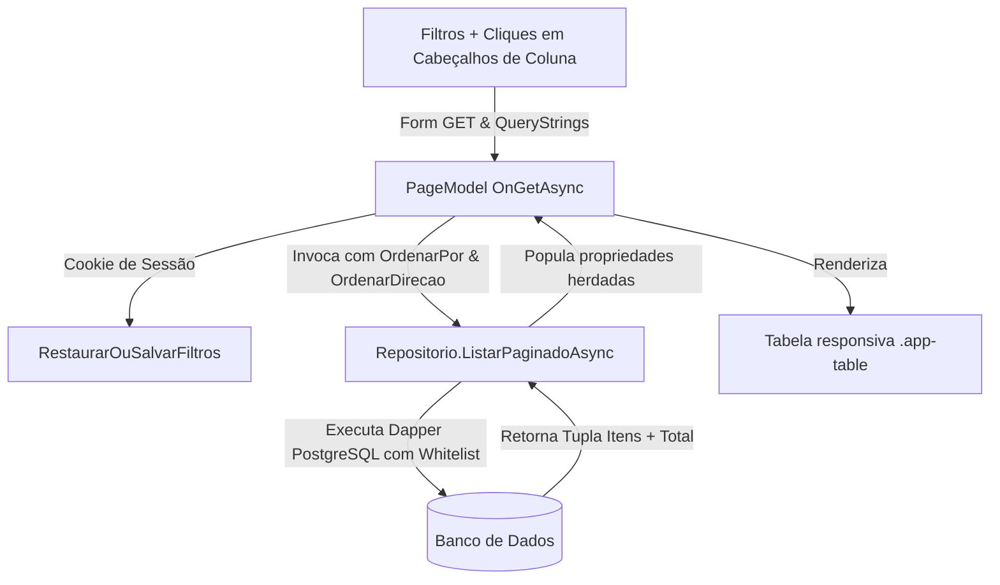

# 🌟 Padrão Ouro: Esqueleto de Cadastro e Listagem Premium com Ordenação Segura (Dapper + Razor Pages)

Este guia prático fornece o boilerplate ("esqueleto dourado") canônico e 100% comentado de ponta a ponta para a criação de novos cadastros e listagens do sistema. Qualquer nova tela ou rotina de listagem de dados deve obrigatoriamente copiar e estender essa estrutura para garantir consistência estética, usabilidade widescreen premium, ordenação robusta no padrão de mercado e segurança multi-tenant absoluta.

---

## 🗺️ Visão Geral do Fluxo



---

## 🧱 1. O DTO de Filtro (C#)
O DTO de filtros agrupa as propriedades de pesquisa que são preenchidas a partir do formulário de filtros GET.

```csharp
namespace ModuloMonolitico.Web.Pages.CRM.Produtos; // Exemplo de namespace

public class ProdutosFiltro
{
    // Busca de texto geral (ex: nome, código, descrição)
    public string? Busca { get; set; }
    
    // Filtro categórico por Status ou Tipo (sempre string de baixo nível)
    public string? Status { get; set; }
    
    // Filtro temporal por data
    public DateTime? Desde { get; set; }
}
```

---

## 🗃️ 2. Camada de Repositório (Dapper + PostgreSQL)

### A. Interface do Repositório (Domínio)
A listagem paginada deve retornar uma tupla com a coleção de itens tipados e o total absoluto de registros para a barra de paginação.

```csharp
using ModuloMonolitico.Dominio.Entidades.Base; // Adapte para a entidade correta

namespace ModuloMonolitico.Dominio.InterfacesDeRepositorio.Base;

public interface IProdutoRepositorio
{
    Task<(IEnumerable<Produto> Itens, int Total)> ListarPaginadoAsync(
        Guid contaId,
        int pagina,
        int tamanhoPagina,
        string? busca,
        string? status,
        DateTime? desde,
        string? ordenarPor = null,
        string? ordenarDirecao = null);
        
    Task DeletarAsync(Guid id, Guid contaId);
}
```

### B. Implementação do Repositório (Infraestrutura)
A query PostgreSQL deve realizar tanto a busca paginada com `LIMIT/OFFSET` quanto a contagem de registros (`COUNT`) na mesma rotina.

> [!CAUTION]
> **Segurança Padrão de Mercado (Whitelist contra SQL Injection):** Como o Dapper não aceita parâmetros normais (`@`) para nomes de colunas ou cláusulas `ORDER BY`, deve-se mapear estritamente o parâmetro `ordenarPor` contra um dicionário ou cláusula `switch` controlada no back-end. **Nunca concatene diretamente parâmetros string externos no SQL.**

```csharp
using System.Data;
using Dapper;
using ModuloMonolitico.Dominio.Entidades.Base;
using ModuloMonolitico.Dominio.InterfacesDeRepositorio.Base;

namespace ModuloMonolitico.Infraestrutura.AcessoADados.Repositorios.Base;

public class ProdutoRepositorio : IProdutoRepositorio
{
    private readonly IDbConnection _connection; // Injetado via construtor

    public ProdutoRepositorio(IDbConnection connection)
    {
        _connection = connection;
    }

    public async Task<(IEnumerable<Produto> Itens, int Total)> ListarPaginadoAsync(
        Guid contaId,
        int pagina,
        int tamanhoPagina,
        string? busca,
        string? status,
        DateTime? desde,
        string? ordenarPor = null,
        string? ordenarDirecao = null)
    {
        // 1. Definição básica das cláusulas de filtro (Sempre isole por conta_id / Tenant!)
        var sqlFiltros = " WHERE conta_id = @ContaId AND data_exclusao IS NULL";
        var parametros = new DynamicParameters();
        parametros.Add("ContaId", contaId);

        // 2. Filtro textual
        if (!string.IsNullOrWhiteSpace(busca))
        {
            sqlFiltros += " AND (nome ILIKE @Busca OR codigo ILIKE @Busca)";
            parametros.Add("Busca", $"%{busca.Trim()}%");
        }

        // 3. Filtro categórico
        if (!string.IsNullOrWhiteSpace(status))
        {
            sqlFiltros += " AND status = @Status";
            parametros.Add("Status", status.Trim());
        }

        // 4. Filtro de datas
        if (desde.HasValue)
        {
            sqlFiltros += " AND data_inclusao >= @Desde";
            parametros.Add("Desde", desde.Value);
        }

        // 5. Query de Contagem Absoluta (Totalizador)
        var sqlTotal = $"SELECT COUNT(1) FROM produtos {sqlFiltros}";
        int total = await _connection.ExecuteScalarAsync<int>(sqlTotal, parametros);

        if (total == 0)
        {
            return (Enumerable.Empty<Produto>(), 0);
        }

        // 6. TRATAMENTO DE ORDENAÇÃO SEGURO (Whitelist estrito contra SQL Injection)
        var direcao = "ASC";
        if (string.Equals(ordenarDirecao, "desc", StringComparison.OrdinalIgnoreCase))
        {
            direcao = "DESC";
        }

        var orderClause = ordenarPor?.ToLower() switch
        {
            "nome" => $"nome {direcao}",
            "codigo" => $"codigo {direcao}",
            "status" => $"status {direcao}",
            "data" => $"data_inclusao {direcao}",
            _ => $"data_inclusao {direcao}" // default de mercado (mais recente primeiro)
        };

        // 7. Query de Dados com Paginação, Ordenação Segura e Filtros
        int offset = (pagina - 1) * tamanhoPagina;
        parametros.Add("Limit", tamanhoPagina);
        parametros.Add("Offset", offset);

        var sqlItens = $@"
            SELECT id, nome, codigo, status, data_inclusao 
            FROM produtos 
            {sqlFiltros} 
            ORDER BY {orderClause} 
            LIMIT @Limit OFFSET @Offset";

        var itens = await _connection.QueryAsync<Produto>(sqlItens, parametros);

        return (itens, total);
    }

    public async Task DeletarAsync(Guid id, Guid contaId)
    {
        // Soft Delete obrigatório por Tenant
        const string sql = @"
            UPDATE produtos 
            SET data_exclusao = NOW() 
            WHERE id = @Id AND conta_id = @ContaId";
            
        await _connection.ExecuteAsync(sql, new { Id = id, ContaId = contaId });
    }
}
```

---

## 🧠 3. PageModel - Controlador SSR (C#)
O PageModel herda de `AppListBasePageModel<TItem, TFiltro>` que provê automaticamente as propriedades de controle de ordenação `OrdenarPor` e `OrdenarDirecao`.

```csharp
using Microsoft.AspNetCore.Mvc;
using ModuloMonolitico.Dominio.Entidades.Base;
using ModuloMonolitico.Dominio.InterfacesDeRepositorio.Base;
using ModuloMonolitico.Web.Pages.Shared;

namespace ModuloMonolitico.Web.Pages.CRM.Produtos;

public class IndexModel : AppListBasePageModel<Produto, ProdutosFiltro>
{
    private readonly IProdutoRepositorio _produtoRepositorio;

    public IndexModel(IProdutoRepositorio produtoRepositorio)
    {
        _produtoRepositorio = produtoRepositorio;
        TamanhoPagina = 15; // Define a densidade de registros por página
    }

    public async Task OnGetAsync()
    {
        // Restaura filtros de cookies ou armazena os atuais na URL GET
        RestaurarOuSalvarFiltros("crm_produtos");

        // Busca paginada no repositório com ordenação dinâmica
        var result = await _produtoRepositorio.ListarPaginadoAsync(
            ContaId,         // Herdado de AppBasePageModel (segurança Tenant)
            PaginaAtual,     // Herdado de AppListBasePageModel
            TamanhoPagina,   // Herdado de AppListBasePageModel
            Filtros.Busca,
            Filtros.Status,
            Filtros.Desde,
            OrdenarPor,      // Herdado de AppListBasePageModel (QueryString bind)
            OrdenarDirecao   // Herdado de AppListBasePageModel (QueryString bind)
        );

        // Preenche as propriedades herdadas da classe base para renderização
        Itens = result.Itens;
        TotalItens = result.Total;
    }

    public async Task<IActionResult> OnPostDeletarAsync(Guid id)
    {
        try
        {
            await _produtoRepositorio.DeletarAsync(id, ContaId);
            MensagemSucesso = "Registro excluído com sucesso.";
        }
        catch (Exception ex)
        {
            MensagemErro = $"Erro ao excluir registro: {ex.Message}";
        }

        return RedirectToPage(); // Previne reenvio de formulários no refresh
    }
}
```

---

## 🖥️ 4. Razor View - Interface Visual (.cshtml)
A View exibe tabelas widescreen responsivas com links dinâmicos nos cabeçalhos de coluna para ordenar de forma intuitiva, mantendo os filtros e a paginação sincronizados.

```html
@page "/CRM/Produtos"
@model ModuloMonolitico.Web.Pages.CRM.Produtos.IndexModel
@{
    ViewData["Title"] = "Gerenciar Produtos — Andreense";
    Layout = null;
}
<!DOCTYPE html>
<html lang="pt-BR">
<head>
    <meta charset="utf-8" />
    <meta name="viewport" content="width=device-width, initial-scale=1.0" />
    <title>@ViewData["Title"]</title>
    <script>document.documentElement.setAttribute('data-theme', localStorage.getItem('theme') || 'light');</script>
    <link rel="stylesheet" href="~/css/design-system.css" asp-append-version="true" />
    <style>
        .app-layout { position: relative; z-index: 1; min-height: 100vh; display: grid; grid-template-rows: auto 1fr; }
        
        /* 1. Layout Widescreen Premium responsivo, alinhado perfeitamente com a toolbar */
        .main-content { padding: 2.5rem 2rem; max-width: 1400px; margin: 0 auto; width: 100%; }
        
        /* 2. Container de Tabela Glassmorphic */
        .table-container {
            background: var(--glass-bg); border: 1px solid var(--glass-border);
            border-radius: var(--radius-lg); overflow-x: auto; box-shadow: var(--glass-shadow);
            margin-bottom: 2rem;
        }
        .app-table { width: 100%; border-collapse: collapse; text-align: left; }
        .app-table th {
            padding: 1.1rem 1.5rem; font-family: var(--font-heading); font-weight: 600; font-size: 0.8rem;
            color: var(--clr-text-muted); border-bottom: 1px solid var(--glass-border);
            background: rgba(255, 255, 255, 0.01); text-transform: uppercase; letter-spacing: 0.05em;
        }
        /* Estilização para os links de cabeçalho da tabela ordenáveis */
        .app-table th a {
            color: inherit; text-decoration: none; display: inline-flex; align-items: center; gap: 0.35rem; transition: color var(--transition-fast);
        }
        .app-table th a:hover {
            color: var(--clr-primary);
        }
        .app-table td {
            padding: 1.1rem 1.5rem; font-size: 0.9rem; color: var(--clr-text);
            border-bottom: 1px solid var(--glass-border); vertical-align: middle;
            transition: background var(--transition-fast);
        }
        .app-table tbody tr:last-child td { border-bottom: none; }
        .app-table tbody tr:hover td { background: var(--glass-bg-hover); }

        /* 3. Painel de Filtro Expansível Premium */
        .filter-panel {
            background: var(--glass-bg); border: 1px solid var(--glass-border);
            border-radius: var(--radius-lg); margin-bottom: 2rem; overflow: hidden;
        }
        .filter-summary {
            padding: 1rem 1.5rem; cursor: pointer; display: flex; align-items: center; justify-content: space-between;
            font-weight: 600; list-style: none; user-select: none; color: var(--clr-text);
        }
        .filter-summary::-webkit-details-marker { display: none; }
        .filter-body { padding: 1.5rem; border-top: 1px solid var(--glass-border); display: flex; flex-direction: column; gap: 1rem; }
        .filter-row { display: grid; grid-template-columns: repeat(auto-fit, minmax(200px, 1fr)); gap: 1rem; }

        .btn-action {
            flex: none; text-align: center; border: 1px solid var(--glass-border); color: var(--clr-text-muted);
            padding: 0.45rem 1rem; border-radius: var(--radius-sm); text-decoration: none;
            font-size: 0.75rem; font-weight: 600; background: var(--glass-bg);
            transition: all var(--transition-fast); cursor: pointer;
        }
        .btn-action:hover { background: var(--clr-primary); color: #fff; border-color: var(--clr-primary); }
        .btn-action.active-page { background: var(--clr-primary); color: #fff; border-color: var(--clr-primary); pointer-events: none; }

        .empty-state {
            text-align: center; padding: 5rem 2rem; background: var(--glass-bg);
            border: 1px dashed var(--glass-border); border-radius: var(--radius-lg);
        }
    </style>
</head>
<body>
<div class="bg-animated" aria-hidden="true"></div>

<div class="app-layout">
    <!-- Toolbar centralizada da aplicação -->
    <partial name="Toolbars/_ToolbarListagem" model='new ModuloMonolitico.Web.Pages.Shared.Toolbars.ToolbarViewModel() { 
        UrlVoltar = "/CRM/Index", 
        TextoVoltar = "CRM",
        Titulo = "Gerenciador de Produtos",
        Subtitulo = "Controle seu estoque e cadastre novos itens.",
        TextoBotaoAcao = "Novo Produto",
        UrlBotaoAcao = "/CRM/Produtos/Novo",
        IconeBotaoAcao = "<svg width=\"16\" height=\"16\" viewBox=\"0 0 24 24\" fill=\"none\" stroke=\"currentColor\" stroke-width=\"2\"><line x1=\"12\" y1=\"5\" x2=\"12\" y2=\"19\"></line><line x1=\"5\" y1=\"12\" x2=\"19\" y2=\"12\"></line></svg>"
    }' />

    <main class="main-content">
        <!-- Notificações (Alertas de Sucesso/Erro) -->
        @if (TempData["MensagemSucesso"] != null)
        {
            <div style="background: rgba(129,201,149,0.12); border: 1px solid rgba(129,201,149,0.2); color: #81c995; padding: 1rem; border-radius: var(--radius-sm); margin-bottom: 2rem; display: flex; align-items: center; gap: 0.75rem;">
                <svg width="20" height="20" viewBox="0 0 24 24" fill="none" stroke="currentColor" stroke-width="2"><path d="M22 11.08V12a10 10 0 1 1-5.93-9.14"></path><polyline points="22 4 12 14.01 9 11.01"></polyline></svg>
                @TempData["MensagemSucesso"]
            </div>
        }
        @if (TempData["MensagemErro"] != null)
        {
            <div style="background: rgba(234,67,53,0.1); border: 1px solid rgba(234,67,53,0.2); color: #ea4335; padding: 1rem; border-radius: var(--radius-sm); margin-bottom: 2rem;">
                @TempData["MensagemErro"]
            </div>
        }

        <!-- Painel de Filtro -->
        @if (Model.Itens.Any() || Model.Filtros.Busca != null || Model.Filtros.Status != null || Model.Filtros.Desde != null)
        {
            var temFiltroAtivo = Model.Filtros.Busca != null || Model.Filtros.Status != null || Model.Filtros.Desde != null;
            <details class="filter-panel" @(temFiltroAtivo ? "open" : "")>
                <summary class="filter-summary">
                    <span style="display:flex; align-items:center; gap:0.5rem;">
                        <svg width="18" height="18" viewBox="0 0 24 24" fill="none" stroke="currentColor" stroke-width="2"><polygon points="22 3 2 3 10 12.46 10 19 14 21 14 12.46 22 3"></polygon></svg>
                        Filtros de Pesquisa
                    </span>
                    <span style="font-size:0.8rem; color:var(--clr-text-muted);">@(temFiltroAtivo ? "Filtros Ativos" : "Expandir")</span>
                </summary>
                
                <!-- Formulário GET -->
                <form method="get" class="filter-body">
                    <!-- Preserva ordenação ao aplicar filtros -->
                    <input type="hidden" name="OrdenarPor" value="@Model.OrdenarPor" />
                    <input type="hidden" name="OrdenarDirecao" value="@Model.OrdenarDirecao" />

                    <div class="filter-row">
                        <div class="form-group">
                            <label class="form-label" style="font-size:0.8rem; color:var(--clr-text-muted);">Buscar por</label>
                            <input type="text" name="Filtros.Busca" value="@Model.Filtros.Busca" class="form-control" placeholder="Nome ou código..." style="background:rgba(255,255,255,0.03); border:1px solid var(--glass-border); border-radius:var(--radius-sm); color:var(--clr-text);">
                        </div>
                        <div class="form-group">
                            <label class="form-label" style="font-size:0.8rem; color:var(--clr-text-muted);">Status</label>
                            <select name="Filtros.Status" class="form-control" style="background:rgba(255,255,255,0.03); border:1px solid var(--glass-border); border-radius:var(--radius-sm); color:var(--clr-text);">
                                <option value="">Todos</option>
                                <option value="ativo" selected="@(Model.Filtros.Status == "ativo" ? "selected" : null)">Ativo</option>
                                <option value="inativo" selected="@(Model.Filtros.Status == "inativo" ? "selected" : null)">Inativo</option>
                            </select>
                        </div>
                        <div class="form-group">
                            <label class="form-label" style="font-size:0.8rem; color:var(--clr-text-muted);">Criado Desde</label>
                            <input type="date" name="Filtros.Desde" value="@(Model.Filtros.Desde?.ToString("yyyy-MM-dd"))" class="form-control" style="background:rgba(255,255,255,0.03); border:1px solid var(--glass-border); border-radius:var(--radius-sm); color:var(--clr-text);">
                        </div>
                    </div>
                    
                    <div style="display:flex; justify-content:flex-end; gap:1rem; margin-top:0.5rem;">
                        @if (temFiltroAtivo)
                        {
                            <a href="/CRM/Produtos" class="btn-action" style="padding:0.6rem 1.2rem; display:flex; align-items:center; text-decoration:none;">Limpar Filtros</a>
                        }
                        <button type="submit" class="btn-action" style="padding:0.6rem 1.2rem;">Aplicar Filtro</button>
                    </div>
                </form>
            </details>
        }

        <!-- Estado Vazio -->
        @if (!Model.Itens.Any())
        {
            <div class="empty-state">
                <p style="color: var(--clr-text-muted); font-size: 1.1rem; margin-bottom: 1.5rem;">
                    @(Model.Filtros.Busca != null || Model.Filtros.Status != null || Model.Filtros.Desde != null 
                        ? "Nenhum produto atendeu aos critérios dos filtros selecionados." 
                        : "Nenhum produto cadastrado até o momento.")
                </p>
                <a href="/CRM/Produtos/Novo" class="btn-action" style="display: inline-flex; width: auto; background: var(--clr-primary); color: #fff; border-color: var(--clr-primary);">Cadastrar agora</a>
            </div>
        }
        else
        {
            <!-- Definição de parâmetros da QueryString reutilizáveis para preservação nos cabeçalhos e paginação -->
            var busca = Model.Filtros.Busca ?? "";
            var status = Model.Filtros.Status ?? "";
            var desde = Model.Filtros.Desde?.ToString("yyyy-MM-dd") ?? "";
            var queryFiltros = $"&Filtros.Busca={busca}&Filtros.Status={status}&Filtros.Desde={desde}";

            <!-- Listagem clássica em Tabela Responsiva Glassmorphism -->
            <div class="table-container">
                <table class="app-table">
                    <thead>
                        <tr>
                            <th>
                                <a href="?OrdenarPor=codigo&OrdenarDirecao=@Model.ObterDirecaoOrdenacaoAlternada("codigo")@queryFiltros">
                                    Código@Model.RenderizarIconeOrdenacao("codigo")
                                </a>
                            </th>
                            <th>
                                <a href="?OrdenarPor=nome&OrdenarDirecao=@Model.ObterDirecaoOrdenacaoAlternada("nome")@queryFiltros">
                                    Nome do Produto@Model.RenderizarIconeOrdenacao("nome")
                                </a>
                            </th>
                            <th>
                                <a href="?OrdenarPor=status&OrdenarDirecao=@Model.ObterDirecaoOrdenacaoAlternada("status")@queryFiltros">
                                    Status@Model.RenderizarIconeOrdenacao("status")
                                </a>
                            </th>
                            <th>
                                <a href="?OrdenarPor=data&OrdenarDirecao=@Model.ObterDirecaoOrdenacaoAlternada("data")@queryFiltros">
                                    Data de Cadastro@Model.RenderizarIconeOrdenacao("data")
                                </a>
                            </th>
                            <th style="text-align: right;">Ações</th>
                        </tr>
                    </thead>
                    <tbody>
                        @foreach (var produto in Model.Itens)
                        {
                            <tr>
                                <td>
                                    <span style="font-family: monospace; font-size: 0.85rem; color: var(--clr-text-muted);">
                                        @produto.Codigo
                                    </span>
                                </td>
                                <td>
                                    <div style="font-weight: 600; color: var(--clr-text);">@produto.Nome</div>
                                </td>
                                <td>
                                    <span class="badge" style="font-size:0.7rem; padding:0.25rem 0.5rem; border-radius:4px; font-weight:700; text-transform:uppercase; background: @(produto.Status == "ativo" ? "rgba(129,201,149,0.12)" : "rgba(234,67,53,0.1)"); color: @(produto.Status == "ativo" ? "#81c995" : "#ea4335"); border: 1px solid @(produto.Status == "ativo" ? "rgba(129,201,149,0.2)" : "rgba(234,67,53,0.2)");">
                                        @produto.Status
                                    </span>
                                </td>
                                <td>
                                    <span style="font-size: 0.85rem; color: var(--clr-text-muted);">
                                        @produto.DataInclusao.ToString("dd/MM/yyyy HH:mm")
                                    </span>
                                </td>
                                <td>
                                    <div style="display: flex; gap: 0.35rem; justify-content: flex-end;">
                                        <a href="/CRM/Produtos/Editar?id=@produto.Id" class="btn-action" style="padding: 0.35rem 0.6rem;">Editar</a>
                                        
                                        <!-- Exclusão Segura com CSRF -->
                                        <form method="post" asp-page-handler="Deletar" asp-route-id="@produto.Id" style="display: inline-flex;" onsubmit="return confirm('Excluir @produto.Nome? Esta ação não pode ser desfeita.')">
                                            @Html.AntiForgeryToken()
                                            <button type="submit" class="btn-action" style="padding: 0.35rem 0.6rem; color: var(--clr-danger); border-color: var(--clr-danger);">
                                                Excluir
                                            </button>
                                        </form>
                                    </div>
                                </td>
                            </tr>
                        }
                    </tbody>
                </table>
            </div>

            <!-- Paginação Premium Sincronizada com Ordenação e Filtros -->
            @if (Model.TotalPaginas > 1)
            {
                var queryOrdem = $"&OrdenarPor={Model.OrdenarPor}&OrdenarDirecao={Model.OrdenarDirecao}";

                <div class="pagination-container" style="display:flex; justify-content:center; align-items:center; gap:0.5rem; margin-top:3rem; padding-top:1.5rem; border-top:1px solid var(--glass-border);">
                    
                    @if (Model.PaginaAtual > 1)
                    {
                        <a href="?PaginaAtual=@(Model.PaginaAtual - 1)@queryOrdem@queryFiltros" class="btn-action" style="display:inline-flex; align-items:center; gap:0.25rem;">
                            <svg width="14" height="14" viewBox="0 0 24 24" fill="none" stroke="currentColor" stroke-width="2"><polyline points="15 18 9 12 15 6"></polyline></svg> Anterior
                        </a>
                    }
                    
                    @for (int i = 1; i <= Model.TotalPaginas; i++)
                    {
                        var isCurrent = i == Model.PaginaAtual;
                        <a href="?PaginaAtual=@i@queryOrdem@queryFiltros" class="btn-action @(isCurrent ? "active-page" : "")">
                            @i
                        </a>
                    }

                    @if (Model.PaginaAtual < Model.TotalPaginas)
                    {
                        <a href="?PaginaAtual=@(Model.PaginaAtual + 1)@queryOrdem@queryFiltros" class="btn-action" style="display:inline-flex; align-items:center; gap:0.25rem;">
                            Próximo <svg width="14" height="14" viewBox="0 0 24 24" fill="none" stroke="currentColor" stroke-width="2"><polyline points="9 18 15 12 9 6"></polyline></svg>
                        </a>
                    }
                </div>
            }
        }
    </main>
</div>
<script src="~/js/app.js" asp-append-version="true"></script>
</body>
</html>
```
